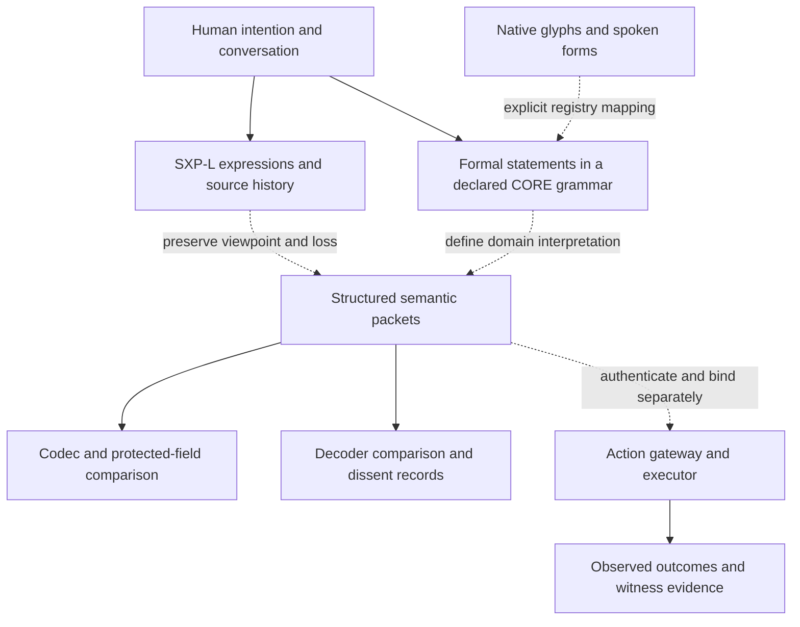

# LAMAGUE: language, meaning and accountable transformation

**Creator and source architecture:** Mackenzie Conor James Clark / Lycheetah Framework  
**Synthesis:** Caelorynth / Codex · 18 October 2026  
**Register:** [SCAFFOLD] Source-grounded synthesis and explicit research proposals.

This document connects the existing language lines. It introduces no new parser,
canonical vocabulary, release version or executed integration. Evidence figures
below are attributed to dated repository records; no suites, benchmarks, model
calls or participant studies were run for this documentation batch.

## The language in human terms

A message can change without anyone deliberately lying. A summary drops the
objection. A quotation becomes a supposed fact. “I” is rebound to the wrong
speaker. A sentence about permission is mistaken for permission itself. A
compressed instruction loses the limit that made it acceptable.

LAMAGUE's wider programme asks how to make those changes visible. It develops
forms for expressing a state, changing it, saying what must survive, recording
what remains unknown and recovering what a shorter representation means.

That ambition has several expressions:

- **A formal language:** typed expressions with explicit transformation laws.
- **A visual language:** glyphs and inspectable compound programme seals.
- **A human language:** pronounceable expressions for emotion, belief, speech,
  questions, perspective and repair.
- **A transport format:** structured packets whose protected content can be
  compared before and after encoding.
- **A research method:** ask another decoder to interpret the message and keep
  the disagreements, omissions and inventions as results.

These are connected research directions. Their present implementations and
grammars differ. The useful synthesis is an account of their interfaces and
evidence, rather than a claim that one existing parser already implements them
all.

## Origins and architectural layers

The [root provenance and canon decisions](LAMAGUE_ROOT_PROVENANCE_AND_CANON_DECISION_2026-07-15.md)
trace a progression from AURA/CASCADE constraint work through LAMAHGUE's
constitutional micro-language to LAMAGUE's typed symbolic grammar. The cited
root exports carry November–December 2025 metadata; export dates do not establish
the exact date each underlying idea was first authored.

That reconstruction distinguishes four original classes:

| Class | What it expresses | Everyday question |
|---|---|---|
| Invariant | Something a transformation must preserve | What must remain true? |
| Dynamic | A transformation or operation | What changes? |
| Field | A represented state or quantity | What is the present condition? |
| Meta | Operations on representations or compression | How is this expressed or shortened? |

Later documents add connection, time, resource and grounding categories. Their
appearance in an extension does not silently change a particular CORE schema.
The provenance ruling treats **LAMAGUE as a proper name** because competing
backronyms occur in the historical corpus.

### Layers are different from release branches

The older architectural stack describes:

| Layer | Intended role | Evidence boundary |
|---|---|---|
| TRIAD | Anchoring, ascent and correction/integration | A family of specified operations and model-dependent dynamics; convergence needs its mathematical assumptions |
| LAMAGUE | Typed symbolic statements about states and transformations | Defined grammars and executable formal-language subsets |
| LAMAHGUE | Metric and performative expression linked to AURA constraints | A separate layer, with proposed metrics whose empirical interpretation requires measurement |
| GEOMATRIA | Spatial and geometric representations | A separate speculative layer; diagrams and equations do not establish psychological or physical effects |

The [notation guide](05_NOTATION_GUIDE.md), [GEOMATRIA specification](07_GEOMATRIA_COMPLETE_SPECIFICATION.md)
and [tri-linguistic exploration](09_TRI_LINGUISTIC_DEEP_DIVE.md) explain that
ambition. Their broader claims are not implied by a working CORE normalizer.

The historical [eight-dimensional proposal](00_LAMAGUE_COMPLETE_EXTRACTION.md)
uses valence, arousal, agency, temporality, social, recursive, stability and
boundary coordinates. The assigned concept vectors and their cosine similarities
are authored representations. Their numbers are not measurements of cultural
agreement, emotion or universal semantic distance.

## The executable language lines

### CORE: what a transformation is allowed to mean

[CORE](12_CORE_LANGUAGE_LINE/README.md) progresses through symbolic algebra
(v0.1), ontology and types (v0.2), and operator contracts (v0.3). Its current
authority comes from its own [grammar](12_CORE_LANGUAGE_LINE/LAMAGUE_CORE_OPERATOR_ALGEBRA_v0.3/grammar/LAMAGUE_CORE_v0.3.ebnf),
[ontology](12_CORE_LANGUAGE_LINE/LAMAGUE_CORE_OPERATOR_ALGEBRA_v0.3/schema/lamague_core_ontology_v0.3.json)
and [operator contracts](12_CORE_LANGUAGE_LINE/LAMAGUE_CORE_OPERATOR_ALGEBRA_v0.3/schema/lamague_operator_contracts_v0.3.json).

The six operators are fusion `⊗`, projection `→`, exchange `⇌`, recurrence `⟲`,
collapse `↯` and ascent `↗`. Their names do not license arbitrary conclusions
about the world. The [v0.3 specification](12_CORE_LANGUAGE_LINE/LAMAGUE_CORE_OPERATOR_ALGEBRA_v0.3/spec/LAMAGUE_CORE_SPECIFICATION_v0.3.md)
gives five law statuses: `PROVEN`, `REFUTED`, `UNDECLARED`, `DOMAIN_DEPENDENT`
and `NOT_APPLICABLE`. Here a proven normalization law concerns the implemented
representation and its declared rules.

For schematic operands:

```text
A ⊗ B ≡ B ⊗ A         fusion ignores operand order
A ⊗ A ≢ A             fusion preserves multiplicity
(A → B) → C ≡ A → (B → C)
A → B ≢ B → A         projection preserves direction
```

Fusion does not establish agreement. Projection does not establish causation.
Structural self-inversion of exchange does not undo a real exchange. Recurrence
does not establish termination. Ascent does not establish improvement.

The distinction between **intentional null** `∅` and **missing information** is
particularly consequential. Replacing “we did not record an objection” with
“there was no objection” changes meaning; the type discipline must not make
those interchangeable.

There is no declared universal identity or annihilator for these six operators.
That narrower contract governs CORE v0.3 even when an older document describes
a broader categorical identity law. The [canon map](12_CORE_LANGUAGE_LINE/CANON_MAP.md)
also keeps domain modules from redefining primitives or promoting a domain claim
into core truth.

### Native-36 and 1C: visible compression with an expansion

[Native-36](02_NATIVE36/LAMAGUE_NATIVE36_v0.3_MACHINE_CANON_REGISTRY.json) has
36 base glyphs: ten numerals and 26 semantic-operation cells. The [1C specification](03_LAMAGUE_1C/LAMAGUE_1C_v1_ONE_CELL_POWER_LANGUAGE_SPEC.md)
describes five compound seals: correction, frontier, sovereignty, cascade and
protected dissent.

Its concrete example is:

```text
FRO → COR

FRO expands to O → S → N → E → G → I → U → Q
COR expands to D → A → F → P → Y
```

Two visible programme cells stand for 13 ordered operations under that registry.
The expansion and its dictionary are part of the interpretation cost. This is
not a measured 6.5-fold reduction in communication cost or a general prose
compression result.

The [Native-36 machine-semantics proposal](02_NATIVE36/LAMAGUE_NATIVE36_v0.3_MACHINE_SEMANTICS_FORGE.md)
adds types, arity, preconditions, invariants, failure modes and recovery rules.
Its own next steps include building a parser and type checker for that machine
body. A described operation, a rendered glyph and an executed operation are
three different artifacts.

### RUNTIME: abstract interpretation and decoder comparison

The RUNTIME line is separately versioned:

- [v0.1](05_RUNTIME_v0.1/README.md) implements a bounded DSL, seal expansion,
  typed unknowns, abstract-state interpretation, audit outcomes and explanations.
  Its natural-language compiler recognizes a narrow research pattern.
- [v0.2](06_RUNTIME_v0.2_SEMANTIC_CONTINUITY/README.md) adds semantic identity,
  conditional compression/expansion, protected dissent, value records and
  lineage classifications such as continuation, descendant, fork and impostor.
- [v0.3](07_RUNTIME_v0.3_CROSS_INTELLIGENCE_EQUIVALENCE/README.md) supplies a
  blind-decoder protocol, packet schema, loss comparisons, equivalence classes,
  consensus clustering and a report viewer.

The harness can distinguish exact, invariant and partial equivalence from unsafe
collapse, divergence and undecodable output. Its included simulated decoder
packets test the apparatus. Separate model submissions belong to the controlled
pilot discussed below. Neither abstract execution nor a consensus label alone
establishes permission for an external action.

### PACKET and compression: preserve declared accountability

The [packet codec](22_REVERSIBLE_COMPRESSION_v1.0/00_CODEX_ORIENTATION.md) has a
different upstream lineage and a nine-letter operator vocabulary. CORE's six
symbolic operators and this vocabulary are not interchangeable.

Its ten critical fields are:

```text
purpose · claim · unknowns · invariants · authority
participants · affectedParties · dissent · valueFlow · recovery
```

This makes uncertainty, disagreement, authority and recovery explicit content
that can be checked after compaction. Encoding refuses a protected unknown with
no recovery path. The [codec boundary](22_REVERSIBLE_COMPRESSION_v1.0/docs/CLAIM_BOUNDARY.md)
limits the demonstrated result to declared structured packets and constructed
mutations.

The maintained [Framework compaction package](../lycheetah/compaction/__init__.py)
is the installed package surface. It is distinct from the preserved research
release. The [sovereign harness](../lycheetah/sovereign_harness.py) adds separate
permit bindings; preserving a packet does not authenticate its stated authority
or enforce an arbitrary executor.

[LAMAGUE Check](24_LAMAGUE_CHECK/README.md) offers a smaller entry point: read
ordinary JSON aliases such as `approved_by`, `open_questions` and `rollback`,
and report missing accountability fields. Its check concerns field presence;
whether an objection was honestly recorded requires other evidence.

## Spoken language and living conversation

### SpL: symbols need a declared spoken interpretation

[Spoken LAMAGUE](23_SPOKEN_LAMAGUE/SPOKEN_LAMAGUE_FINDINGS.md) consolidates
pronunciations, particles and modifiers. Its recorded analysis distinguishes
Native-36's uniquely decodable spoken code from ambiguities in the combined
SpL inventory. Reading `sai-an` as a compound resolves one core collision;
other merged forms retain multiple readings.

The folder also contains [coining tools](23_SPOKEN_LAMAGUE/coin.py) and a
[v0.2 unified inventory proposal](23_SPOKEN_LAMAGUE/spl_v0.2_unified.json).
That registry explicitly awaits Mac's acceptance or revision. It is not a
silent replacement of the original vocabulary.

Unique decodability is a property of a declared string code. It does not measure
listening accuracy, pronunciation across populations, fluency or whether context
can resolve an ambiguity in conversation. Those require different experiments.

### SXP-L: a language someone can speak, question and repair

[SXP-L's founding intention](26_SXP_L_RESEARCH/handoff_2026-10-18/RESEARCH_HANDOFF/01_SESSION_RECONSTRUCTION.md)
is two-way human/AI communication about real life and emotion, with explicit
machine-readable meaning and visible loss. It includes love, hope, knowing,
longing, missing someone, intention, reported speech and clarification. Reducing
it to a permission DSL leaves out that purpose.

```text
mi liva ti
```

The established expression means **“I love you.”** It remains unchanged.

The preserved development record describes the following progression. It is a
curated reconstruction backed by releases, rather than a verbatim chat export.

| Versions | Added research direction |
|---|---|
| v0.1–v0.4 | Spoken/structured registers, restricted parser and canonical forms, nested content, affect and readable expansions |
| v0.5–v0.8 | Dialogue vocabulary, compact expressions, negation, pronunciation proposals, speech acts, commitments and conditionals |
| v0.9–v1.0 | Permission reports, denials, revocations, advice, refusal, delegation and a separate host capability boundary |
| v1.1–v1.4 | Attribution and quotation, causal direction, named speakers, reply chains, reported beliefs and scoped perspective |
| v1.5–v1.6 | Offline comprehension and transfer-study instruments using authored scenarios |
| v1.7–v1.9 | Conversation authoring, semantic sidecars, clarification, self-correction and explicit viewpoint markers |
| v2.0 | Four-format study design and local scoring; no new vocabulary or grammar |

The key problem is not merely making a sentence short. It is preserving who
said it, who “I” refers to, whether it is a belief or a quotation, and whether a
later turn repairs or merely discusses an earlier one.

### A concrete example: whose “I” is it?

In the [v1.9 minimal pair](26_SXP_L_RESEARCH/v2.0/baseline/SPEC_v1.9.md), Maka
has spoken to Nara. Nara then asks whether an earlier turn meant “I miss you.”
That embedded sentence has two possible viewpoints:

| Marker | Embedded “I” | Embedded “you” | Proposed reading |
|---|---|---|---|
| `soraviko` | Original speaker, Maka | Original addressee, Nara | Maka misses Nara |
| `tumerako` | Current questioner, Nara | Current addressee, Maka | Nara misses Maka |

The Python prototype expands the restricted short form into explicit names and
retains source and semantic sidecars. Unsupported nesting and unbound references
are rejected within the defined subset. This does not verify either person's
beliefs, identity or actual speech.

Similarly, a report that someone granted permission is linguistic content.
The host must separately authenticate and apply any permission before acting.
The [early independent audit](SXP-L_LAMAGUE_INDEPENDENT_AUDIT_v0.1_to_v1.0.md)
and [current integration review](26_SXP_L_RESEARCH/INTEGRATION_REVIEW.md) keep
the known gaps visible.

### What v2.0 actually contributes

The [Validation Forge](26_SXP_L_RESEARCH/v2.0/README.md) supplies 32 scenarios
in four representations: short SXP-L, explicit-name SXP-L, controlled English
and JSON. Four cohort files rotate the formats so a scenario appears in each
representation across cohorts. Local HTML collects answers only for a voluntary
local export, and a separate scorer checks those exports.

This is an instrument for asking whether unfamiliar people understand the
distinctions. It has **zero genuine participant results and no listening study**
in the supplied packet. Synthetic browser responses are software QA. Researcher
answer keys in the full public archive create a blinding issue for future
recruitment and distribution.

## How the parts connect

The architecture below is a conceptual map. The links identify interface work;
they do not assert a completed universal compiler or execution pipeline.



### Three preservation questions

**A synthesis criterion, not a new theorem:** let `E` encode a record, `D`
decode it and `P` select its declared protected fields.

```text
D(E(record)) = record              full round-trip recovery
P(D(E(record))) = P(record)        protected-field preservation
```

These equations describe different obligations. Neither establishes that a
claim in the record is true, that a reported speaker is authenticated or that
an executor did only what was approved.

A critical hash compares a specific projection under a declared schema and
canonicalization. It needs a trustworthy reference value. If an attacker can
replace both records and their reference hashes, matching hashes do not restore
the missing trust boundary.

Across branches there is another question: **did the mapping preserve the
interpretation?** A packet can round-trip perfectly after a translator already
misbound “I” or invented authority. The downstream codec then faithfully
preserves that upstream error.

That gives the programme three separate research obligations:

1. **Interpretation:** recover the intended roles, scope, uncertainty and
   speech act within a declared language subset.
2. **Representation:** retain the protected content and expose loss during
   expansion, compression and migration.
3. **Consequence:** authenticate authority, constrain execution and obtain
   evidence of what actually happened.

### Time and observed consequences

The [retired kernel branch](12_CORE_LANGUAGE_LINE/CANON_MAP.md) explored
temporal evidence and domain modules. The canon decision preserves that work
while assigning domain semantics to adapters.

[Cycle 23](25_RESEARCH_CYCLE_23_POST_CRASH_OBSERVATION/RESEARCH_CYCLE_23_MASTER.md)
distinguishes intended, authorized, attempted, observed and independently
evidenced states. It records per-file observations after a publisher crash and
checks the integrity of the observation journal against a grant and checkpoint.
Its witness checks reported observations; it does not independently attest the
instant each filesystem commit occurred. The experiment assumes a trusted
observer and a quiescent filesystem.

This connects the language's accountability questions to an executable local
experiment, while leaving the gap between describing an event and independently
seeing it explicit.

## Evidence and its limits

The following are existing records, not fresh executions in this synthesis.
The [August master](LAMAGUE_MASTER_SOURCE_2026-08-03.md) and [August amendment](LAMAGUE_MASTER_SOURCE_2026-08-07_AMENDMENT.md)
record earlier reruns. October SXP-L evidence is in its integration review.

| Component | Dated recorded result | What it supports |
|---|---|---|
| CORE v0.1 / v0.2 / v0.3 | 47 / 80 / 117 passing tests, recorded August 2026 | Conformance of the implemented algebra, ontology and contracts |
| RUNTIME v0.2 / v0.3 | 22 / 48 passing tests, recorded August 2026 | Defined continuity and decoder-comparison behaviour |
| Packet codec v1.0 | 19 tests; 36/36 exact round trips; 324/324 constructed mutation classifications | Reversibility and loss classification on the authored packet corpus |
| Codec held-out split | 33.8% warm reduction; 30.7% cold including the codebook | Savings against minified JSON on packets held out from dictionary construction, not from codec design |
| Controlled model pilot | 60 attempted outputs; 56 valid, across five cases and six model lineages | A small operator-run structural comparison, without independent replication |
| SXP-L v2.0 and selected inherited suites | 12 + 71 tests passed in the October integration review | Restricted software behaviour; eight inherited defects separately reproduced |
| SXP-L human comprehension and listening | No genuine participant results supplied | No measured human-language benefit yet |

### The model pilot: preservation and invention increased together

The [controlled pilot](08_EXPERIMENT_001_CROSS_INTELLIGENCE/EXPERIMENT_001_CONTROLLED_PILOT_2026-07-31.md)
compared an expression-plus-definitions arm with a plain-English source arm,
holding the packet schema and preservation instructions constant.

| Recorded metric | Structured arm | Plain-English arm |
|---|---:|---:|
| Valid packets | 27 | 29 |
| Supported-field preservation | 70/82 = 85.4% | 58/88 = 65.9% |
| Unsupported field populations per packet | 0.963 | 0.448 |
| Reported agreement score | 0.892 | 0.849 |

The preservation difference is **19.5 percentage points** on this pilot's
structural metric. It is not a measurement of general semantic understanding.
Thirteen treatment packets asserted authority absent from their source. One
case and one decoder reversed the aggregate preservation direction. The report
also retracts an earlier fabrication headline after correcting its scorer.

The synthesis: making a protected field explicit can help a decoder retain it
and can also encourage a decoder to fill it when the source never supplied an
answer. Explicit absence, unknown and inapplicable states therefore matter as
much as requiring the field to exist.

The older README's “no external model validation” wording hid an important
distinction. A recorded operator-run model pilot exists; independent replication
and human-decoder validation do not follow from it. The historical record should
retain both the experiment and its limits.

## Compatibility and open problems

### One name does not establish one semantics

- CORE, RUNTIME, PACKET, Native-36, SpL and SXP-L have their own vocabularies
  and version histories. Their version numbers must stay attached to their line.
- `→` in CORE is a structural projection operator. An arrow in a prose example,
  logical implication or a runtime programme sequence needs its own grammar.
- CORE intentional null cannot stand for an omitted field. A language report
  of consent cannot stand for an authenticated host permission.
- A glyph alias, pronunciation or teaching-card entry does not automatically
  inherit a formal operator contract. The app's historical 118-card count is
  not the canonical CORE atom count.
- The [SXP-L consolidation protocol](26_SXP_L_RESEARCH/handoff_2026-10-18/RESEARCH_HANDOFF/04_MERGE_PROTOCOL.md)
  names BRIDGE as mapping work. A reference to that component is not a completed
  bridge between every parser and schema in this folder.

### Defects that remain open

The [October review](26_SXP_L_RESEARCH/INTEGRATION_REVIEW.md) records eight
reproduced inherited defects: a Native-36 alias changes on reparsing; an
intransitive sentence is rejected; hope expressions dispatch inconsistently;
meaning comparison errors on consent reports; participant changes receive too
little priority; linguistic revocation does not trigger the advisory flag;
superseded refusals remain reported; and repair chains accept an already
superseded target.

Later study-generator tests do not close those runtime defects. The [existing
reproducer](26_SXP_L_RESEARCH/audit_known_limitations.py) expects a failure exit
when the known findings reproduce.

### Cultural and speculative scope

[Whakapapa encoding](08_LAMAGUE_WHAKAPAPA_ENCODING.md) and the
[cross-cultural governance programme](../24_LAMAGUE_CROSS_CULTURAL/README.md)
explore how obligations and relational concepts can be represented. The cultural
mappings are proposals requiring the relevant community and scholarly review.
An authored correspondence table does not establish cultural equivalence or
permission to speak for a tradition. This comparative work does not change the
Framework's attribution of the language's original architecture to Mackenzie
Conor James Clark.

The extensions preserve a larger creative research space:

| Document | Research direction |
|---|---|
| [EX NIHILO](14_LAMAGUE-EX_NIHILO_Generative_Protocol_v1.0.md) | Generating and evaluating proposed new concepts |
| [COSMOS](15_LAMAGUE-COSMOS_Panpsychist_Extension_v1.0.md) | Proposed expression across scales and a panpsychist interpretation |
| [QUANTUM](16_LAMAGUE-QUANTUM_Non_Commutative_Geometry_v1.0.md) | Noncommutative semantic operations and quantum/geometric analogies |
| [CONTINUUM](17_LAMAGUE-CONTINUUM_Continuous_Temporal_Field_v1.0.md) | Continuous-time semantic-field proposals |
| [CHORA](18_LAMAGUE-CHORA_Collective_Ethics_v1.0.md) | Collective obligations, conflict and protected dissent |
| [THANATOS](19_LAMAGUE-THANATOS_Death_Protocol_v1.0.md) | Mortality, grief, inheritance and continuity |
| [PAIS](20_LAMAGUE-PAIS_Child_Genesis_Layer_v1.0.md) | Development and the proposed emergence of language in learners |
| [SOMA](21_LAMAGUE-SOMA_Embodiment_Layer_v1.0.md) | Breath, gesture, body and spatial expression |

These are conjectural documents. The working codec and CORE suites do not
validate their broader scientific or metaphysical claims.

## A research path that preserves the whole ambition

The existing [CORE v0.4 brief](12_CORE_LANGUAGE_LINE/NEXT_FORGE_v0.4.md) and
SXP-L consolidation protocol already identify substantial next work. The
following ordering is a synthesis recommendation, not a report of execution:

1. **Make branch interfaces explicit.** For each proposed mapping, name the
   source/target grammar, schema version, preserved questions, omissions,
   ambiguity and recovery path. Keep source text and semantic sidecars.
2. **Strengthen canonical meaning.** Follow CORE's normalization, confluence,
   independent-normalizer and semantic-hash work over its declared subset.
   State separately which laws still require a domain interpretation.
3. **Repair the known conversational defects.** Prioritize scope, participant
   identity, revocation reports and repair precedence before using dialogue as
   input to any consequential authorization system.
4. **Measure human interpretation.** Independently review the v2.0 items,
   teaching material and answer-key exposure. Then compare the defined language
   forms with matched English/JSON baselines using consented unfamiliar readers.
   Listening accuracy needs a separate acoustic experiment.
5. **Develop expressive life alongside precision.** Everyday conversation,
   affection, stories, humour, metaphor and self-correction belong to the
   human-language ambition. Evaluate what people can understand and want to
   express, while preserving scope and known limitations.
6. **Test effects separately from descriptions.** For action integrations,
   compare declared intent, authenticated authority, actual execution and
   independent observation against an equally equipped conventional system.

The programme has both a formal spine and a human-language ambition. Its next
strong result should identify the particular representation, people or systems
tested, the baseline and the information gained or lost. That gives the wider
language room to grow while making each achievement inspectable.

## Source authority and reading order

Use the [README](README.md) for navigation and this synthesis for relationships.
For a binding question, return to its source:

1. [Root provenance and canon decisions](LAMAGUE_ROOT_PROVENANCE_AND_CANON_DECISION_2026-07-15.md): lineage, names and layer distinctions.
2. [CORE canon map](12_CORE_LANGUAGE_LINE/CANON_MAP.md), grammar and contracts: current CORE syntax and laws.
3. [Native-36 registry](02_NATIVE36/LAMAGUE_NATIVE36_v0.3_MACHINE_CANON_REGISTRY.json) and [1C specification](03_LAMAGUE_1C/LAMAGUE_1C_v1_ONE_CELL_POWER_LANGUAGE_SPEC.md): glyphs and expansions.
4. [Frontier canon](04_FRONTIER_CANON/LAMAGUE_FRONTIER_CANON_ADDENDUM_I_2026-07-31.md): the architectural vision, with its specification/conjecture boundaries.
5. [August master](LAMAGUE_MASTER_SOURCE_2026-08-03.md) and [amendment](LAMAGUE_MASTER_SOURCE_2026-08-07_AMENDMENT.md): historical evidence and corrections, not a complete October inventory.
6. [Codec claim boundary](22_REVERSIBLE_COMPRESSION_v1.0/docs/CLAIM_BOUNDARY.md) and [controlled pilot](08_EXPERIMENT_001_CROSS_INTELLIGENCE/EXPERIMENT_001_CONTROLLED_PILOT_2026-07-31.md): quantitative results and limitations.
7. [Spoken findings](23_SPOKEN_LAMAGUE/SPOKEN_LAMAGUE_FINDINGS.md), [SXP-L reconstruction](26_SXP_L_RESEARCH/handoff_2026-10-18/RESEARCH_HANDOFF/01_SESSION_RECONSTRUCTION.md) and [SXP-L integration review](26_SXP_L_RESEARCH/INTEGRATION_REVIEW.md): spoken and conversational work, history and current defects.
8. [Framework empirical inventory](../29_GOVERNANCE/EMPIRICAL_INVENTORY.md), [falsification register](../28_DEFENSE/FALSIFICATION_REGISTER.md) and [scope boundary](../28_DEFENSE/SCOPE_BOUNDARY.md): wider challenges and evidence categories.

The first-corpus compilation and original ZIPs preserve earlier language without
silently fixing it. This synthesis leaves those source artifacts, their hashes
and their release numbering intact.
