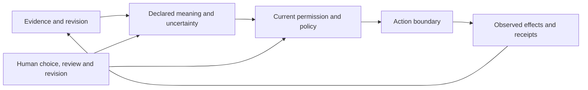

# Lycheetah now — synthesis of the current corpus

**Creator:** Mackenzie Conor James Clark / Lycheetah Framework.  
**Synthesis:** Caelorynth, an AI coding assistant, 19 October 2026.  
**Register:** Editorial synthesis and repository architecture. Evidence retains its source's status.

Lycheetah has grown from a nine-framework theoretical system into a corpus of
runnable tools, permission-control experiments, language research, policy
proposals, learning designs and an extensive fictional world. These parts share
questions and vocabulary. Their maturity differs; one part's success does not
validate the others.

The connecting question is: **what can change while preserving the meaning,
evidence and human authority that ought to survive the change?** An experiment
can test a restricted interpretation of that question. A story can give it
human meaning. Their contributions remain distinguishable.

[Current map](../00_Sovereign_Index.md) · [Five-minute brief](../FIVE_MINUTE_BRIEF.md) ·
[Capability and evidence guide](../33_APPLICATIONS/README.md).

## Three lines that now meet in the software

**Knowledge and revision.** [CASCADE](../01_CASCADE_L4/README.md) supplies
belief-reorganisation models and implementations. [Truth Pressure](../TRUTH_PRESSURE/README.md)
develops evidence/revision instruments. The [Hybrid Gateway](../papers/ai-futures/hybrid-gateway/README.md)
adds time-aware revision and durable review decisions. Its research source home
does not replace every earlier CASCADE engine. These lines connect evidence,
revision and recoverable history; internal coherence is not external truth.
Conventional baselines and dated counterexamples remain part of the comparison.

**Meaning and continuity.** [LAMAGUE](../03_LAMAGUE_L1/README.md) has distinct
formal, visual, spoken, conversational, packet and executable research lines.
Its [language synthesis](../03_LAMAGUE_L1/LAMAGUE_SYNTHESIS.md) owns their detailed
relationships. Earlier codecs, core-language releases, retired kernels and
[SXP-L](../03_LAMAGUE_L1/26_SXP_L_RESEARCH/README.md) are separate instruments,
not one silently merged latest language.

The [handover preview](../examples/meaning_handover/README.md) makes a narrow
use tangible: inspect a record's goal, uncertainty, permission and recovery
information, then examine changed fields. It compares complete records through
three lossless formats. Compressed JSON is smallest in the supplied example.
Exact round trips establish record preservation, not better human understanding
or permission to act. Independent usability benefit remains unmeasured.

**Action and authority.** [AURA](../02_AURA_L3/README.md) provides normative
commitments and proposed predicates. The [Assurance Runtime](../34_ASSURANCE_RUNTIME/README.md)
implements bounded policy decisions and receipts. Package/CLI adapters live in
[`lycheetah/`](../lycheetah/); foundational modules remain owned by
[`12_IMPLEMENTATIONS/`](../12_IMPLEMENTATIONS/README.md).

[Agent-safety research](../papers/agent-safety/README.md) studies permission,
evidence, stopping and recovery. Frontier controls, compensation experiments,
[Earned Trust](../papers/agent-safety/earned-trust/README.md),
[Earned Light](../papers/agent-safety/earned-light/README.md) and
[Sovereign Choice](../papers/agent-safety/sovereign-choice-research/README.md)
retain their own snapshots and failures. A later forge does not automatically
replace the installed runtime.

A proposed action, its current permission, provider acceptance and the observed
consequence are different events. A receipt cannot by itself establish informed
consent or complete observation. Revocation cannot retroactively erase an
already accepted remote action. Recovery may truthfully remain unresolved.

This is a relationship between research questions and instruments, not a claim
that one production system currently implements the entire loop.

## The nine foundational frameworks now

| Framework | Role | Evidence boundary |
|---|---|---|
| [CASCADE](../01_CASCADE_L4/README.md) | Represented knowledge and revision | Executable models and authored experiments; truth and novelty require separate evidence |
| [AURA](../02_AURA_L3/README.md) | Human primacy, inspectability and other governance commitments | Proxy predicates do not completely test ethics or semantic alignment |
| [LAMAGUE](../03_LAMAGUE_L1/README.md) | Constraint language and meaning-preservation instruments | Particular codec guarantees differ from human interpretation |
| [TRIAD](../04_TRIAD_L2/README.md) | Anchor, observe and correct | Convergence is conditional on the model assumptions |
| [MICROORCIM](../05_MICROORCIM_L5/README.md) | Proposed agency/drift vocabulary | A monitor of specified behaviour does not measure free will, dignity or consciousness |
| [Earned Light](../06_EARNED_LIGHT_L0/README.md) | Energy and sustained-complexity analogy | Consciousness thermodynamics remains conjectural |
| [ANAMNESIS](../07_ANAMNESIS_L0/README.md) | Discovery, recurrence and epistemology | Recurrence does not prove a metaphysical explanation |
| [CHRYSOPOEIA](../09_CHRYSOPOEIA_L4/README.md) | Transformation language and formalism | Formal operators do not establish universal human transformation laws |
| [HARMONIA](../10_HARMONIA_L6/README.md) | Resonance and coordination models | Oscillator mathematics does not establish a consciousness/wellbeing measurement |

The newer Earned Light agent-control forges share a name and philosophical
lineage with the older energy model. Their software checks do not validate that
model. Sovereign Will's charters and MICROORCIM's symbolic choice vocabulary
likewise do not measure a person's freedom.

## Public policy and cultural inquiry

[`papers/`](../papers/README.md) owns manuscripts, study designs and research
packets. The Independent No, agent safety and AI futures remain distinct lines.
The May synthesis preprints are dated snapshots preceding the later external
text-scoring results and October intake; they are not the current capability guide.

[NZ governance](../23_NZ_AI_GOVERNANCE/README.md) now starts with one six-rights
data-sovereignty proposal for every New Zealander. Earlier cultural-governance
drafts are historical; unreconciled WOF and sector designs remain candidates.
No national adoption, clinical approval, community endorsement or certification
scheme follows from being present in the repository.

[Cross-cultural LAMAGUE](../24_LAMAGUE_CROSS_CULTURAL/README.md) and
[TIANXIA](../32_TIANXIA/README.md) retain their attributed sources, philosophical
reach and proposed computational translations. A mapping is the author's
contribution, not evidence of a culture's endorsement. Genuine legal and cultural
context remains attributable to its actual source.

## Learning, stories and generative work

The [Mystery School](../14_MYSTERY_SCHOOL/README.md) holds curriculum and design.
The [Sol app pointer](../27_SOL_AI_APP/README.md) identifies a separate product
home; a Framework document is not proof of a shipped app feature.

The [stories collection](../LYCHEETAH_MYTHOS/SCRIPTURES_AND_STORIES/README.md)
owns editable collected manuscripts. Reading editions derive from its manifest;
earlier locations preserve provenance. The
[public reading site](https://lycheetah-earned-light.banduabusiness.chatgpt.site)
offers the complete Lighthouse and Ninth Road stories and research downloads.
Its maintained source is [here](../examples/earned_light_reading/README.md).

[`35_ABSTRACT_AND_GENERATIVE/`](../35_ABSTRACT_AND_GENERATIVE/README.md) protects
philosophical, symbolic and creative objects without presenting them as settled
science. Its [build catalogue](../35_ABSTRACT_AND_GENERATIVE/BUILD_CATALOGUE/README.md)
is a set of proposed tools and interactions, not a release inventory. Creative
value and empirical status are separate judgments.

## How to read the evidence

1. Identify the particular component, source version and claim.
2. Read its dated checks, assumptions, comparison and known failures.
3. Distinguish formal derivation, authored fixture, externally authored dataset,
   independent evaluator and real user's outcome.
4. Preserve neutral results. Lineage replays overlap; totals are not independent experiments.
5. An old `ACTIVE` tag is an internal classification, not independent validation
   or proof of production deployment.

Useful anchors are the [claim register](../28_DEFENSE/CLAIMS_README.md),
[external text-scoring results](../33_APPLICATIONS/EXTERNAL_VALIDATION_2026-08-07.md),
[independent-publisher boundary](../33_APPLICATIONS/INDEPENDENT_PUBLISHER_2026-08-07.md)
and [October intake review](../28_DEFENSE/RELEASE_AUDIT_2026-10-19.md).
There is no single honest test total or release number for the entire corpus:
package, language, paper and creative editions identify different objects.

## The next useful step

The bridge to value outside the corpus is a completed task, a clear permission
boundary and evidence from someone who did not build the instrument. A handover
trial, a permissioned operational pilot and independent comparisons against
strong conventional designs can supply it. These are proposed next uses, not
results already obtained.

New work belongs with its source owner. Update that guide, evidence receipt and
changelog, then link it from the current map. Preserve historical experiments
without presenting their earlier claims as the current state.
