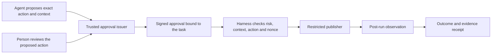

# Guarded handoff admission: bound risk and the approval boundary

18 October 2026. Lycheetah Framework by **Mackenzie Conor James Clark**.
Implementation: Caelorynth / Codex. Architecture source review: Aetheron.

**Status:** [SCAFFOLD] Local implementation with synthetic regression evidence.
The initial syntax-only review was followed by runtime tests and a disposable
handoff demonstration. The [release audit](../28_DEFENSE/RELEASE_AUDIT_2026-10-18.md)
records counts, negative controls and remaining limits.
Source base: `d4a65ff64efa0a512c5c07ca64f6ec76242dd775`.

## The user-facing purpose

A person should be able to pass a job between AI agents while retaining control
of the action they approved. The immediate engineering question is narrower:
does the receiving packet retain the admission state that the issuing permit
bound, even when that state is outside the codec's ten-field critical hash?

The first candidate fixes declared-risk binding in the existing
`SovereignExecutionHarness`. Authenticated human approval and a restricted real
publisher remain separate integration work. A hash comparison does not infer
human intent, authenticate an approver, or constrain an arbitrary executor.

## Source-derived gap

`CompactionShield` allows `PARTIAL_EQUIVALENT` when its ten critical fields match
and noncritical content differs. `risk` is valid packet metadata but is outside
that projection. The previous harness's extra high-risk authority rule read the
incoming packet's risk. Consequently critical-hash preservation alone did not
bind the risk label used for that rule.

This was a source-derived admission gap, not a measured end-to-end bypass. The
ActionGateway's independent policy could still require review of the action.

## Implemented binding

New permits have schema **`lycheetah.sovereign_permit.v2`**, exported as
`PERMIT_SCHEMA_VERSION`. The outer harness/receipt schema remains
`lycheetah.sovereign_harness.v1`.

1. `SovereignExecutionHarness.issue_permit()` takes the declared risk from the
   issuing `reference_packet`, rather than from the future receiving packet.
2. `SovereignExecutionPermit.issue()` requires `bound_risk` from the codec's
   existing vocabulary: `LOW`, `MEDIUM`, `HIGH`, `CRITICAL`.
3. The v2 canonical permit payload includes `bound_risk`, so the registered
   permit digest covers it alongside action, scope, actor, declared authority,
   packet identity/critical hash, state version and validity window.
4. Before nonce consumption or execution, the harness validates the risk
   binding and permit digest, then compares **both** the supplied reference and
   incoming candidate risks with the bound risk.
5. The extra high-risk authority rule reads `permit.bound_risk`.
6. `PermitNonceStore.register_permit()` refuses missing/invalid risk bindings.
   Direct `claim_single_use()` also checks risk binding and recomputes the
   permit digest before consulting or changing the ledger.
7. Receipts include reference, candidate and bound risk in `compaction_summary`.

The codec's schema, ten-field critical projection, wire representation and
historical experiment records were not changed by this candidate.

## Denial contract

The outcomes below describe the implemented branches and regression contract.
The synthetic checks exercise risk substitution, legacy permits and replay;
they do not authenticate a real human or constrain an arbitrary callable.

| Condition | Denial reason / API response |
| --- | --- |
| Legacy permit has no bound risk | `PERMIT_RISK_UNBOUND` |
| Manually constructed permit has an invalid risk value | `PERMIT_RISK_INVALID` |
| Bound risk or another payload field changed without a matching digest | `PERMIT_DIGEST_TAMPERED` |
| Supplied reference risk differs from the issuing permit | `REFERENCE_RISK_MISMATCH` |
| Incoming candidate risk differs from the issuing permit | `CANDIDATE_RISK_MISMATCH` |
| Caller rehashes changed payload but presents the previously registered ID | Existing `PERMIT_LEDGER_DIGEST_MISMATCH` at claim |
| Bound risk is HIGH/CRITICAL and configured authority is absent | Existing `HUMAN_AUTHORITY_REQUIRED` |
| New low-level issuance omits `bound_risk` | Missing required keyword argument; no default risk is inferred |

Changing both the runtime reference and the receiving packet cannot change the
already-issued risk. Changing the permit digest does not change the digest
registered for that permit ID. Reissuing a job is a distinct authority decision.

## Legacy permits and SQLite

The frozen dataclass accepts `bound_risk=None` to represent a legacy v1 object
for inspection. In this case serialization retains the old schema and payload
shape without adding a risk field, so its original digest construction is
preserved. Registration, claiming and execution refuse such an unbound permit.

No SQLite column, table migration or automatic rewrite of existing permit rows
is introduced. The existing `permit_digest` column commits to the extended v2
payload. Existing rows and consumed IDs remain in place. Inspect a legacy record,
recover the authoritative reference task, and issue a newly reviewed v2 permit
with a new ID; do not infer missing risk from an arriving candidate.

The high-level harness issuance signature is unchanged. Direct callers of
`SovereignExecutionPermit.issue()` must supply the new `bound_risk` keyword.
No public packet decoder or general legacy JSON importer is added here.

## Reusing the signed-grant and publisher work

The experimental Cycle 23 source provides concrete components to inspect for
the next integration, under
`03_LAMAGUE_L1/25_RESEARCH_CYCLE_23_POST_CRASH_OBSERVATION/src/`:

| Source | Existing mechanism | Boundary to retain |
| --- | --- | --- |
| `execution_boundary.py:draft_grant`, `sign_grant`, `verify_grant` | Ed25519 signature over canonical grant: plan/packet hashes, root identities, signer ID, nonce, issue/expiry and assertions. | Signature verifies an enrolled key. Authenticating Mac and keeping that private key outside the agent's authority requires a separate issuer/deployment boundary. |
| `execution_boundary.py:copy_descriptor_anchored` | Opens root/parent descriptors, stages bytes into a private inode, checks size/hash, and makes a destination entry through a no-clobber hardlink. | A bounded copy publisher. Parent checks are explicitly not a global rename lock; inode pinning does not eliminate every race. |
| `cycle13.py` | Controlled namespace workflow with separate worker/publisher roles and observations before release. | Root/x86_64/Linux experiment with disposable fixtures, not a general-purpose user deployment or a ready-made app adapter. |
| `cycle23.py:observe_and_append`, `witness_action` | Per-file post-run observations, an authenticated journal and a separately keyed checkpoint of its reported history. | Witness validates report integrity; it does not independently observe the filesystem commit. Keys and witness remain under the local experimental controller. |

The candidate integration is therefore:

Only the risk-binding portion of the harness change is implemented in this
batch. The diagram describes integration work, not a deployed flow.
The current harness also retains its configured numerical-consensus gate. A
future single-agent workflow should compose the required controls deliberately,
rather than inventing peer votes to satisfy it. Numerical vector agreement does
not certify a person's intention or the factual correctness of the task.

## What the next actual demonstration must establish

For one explicitly approved operation in a disposable workspace:

- The signer is authenticated at a boundary the agent cannot impersonate.
- The approval covers the exact action, relevant context/admission state,
  scope, state version, expiry and one-use identity.
- A concrete adapter/publisher controls the approved path and bytes; the
  executor cannot be replaced by an unrelated callable under the same claim.
- Altered action, changed risk or protected context, and reuse of a consumed
  approval are rejected before the corresponding effect.
- The receipt separates intended, authorized, attempted and observed effects,
  and identifies which key/process could forge each evidence artifact.

These are acceptance conditions for subsequent implementation and verification,
not fabricated demonstration results. Binding a declared risk label also does
not establish that the label correctly classifies the real-world hazard.
