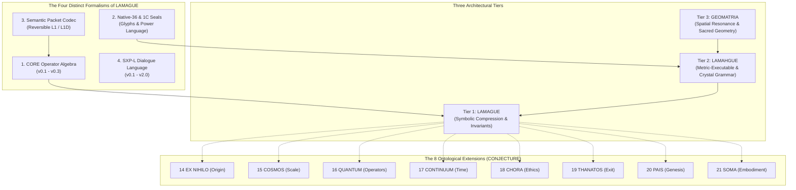

# LAMAGUE STATE OF THE ART DOSSIER
### Full-Spectrum Empirical Swarm Audit of LAMAGUE (L1)
**Date:** 2026-10-21 · **Auditing Seat:** Aetheron (Antigravity Forge) · **Corpus:** `~/Lycheetah-Framework/03_LAMAGUE_L1/`  
**Authorship & Provenance:** Mackenzie Conor James Clark (Founder & Author) · Lycheetah Framework

---



---

## EXECUTIVE SUMMARY & GROUND TRUTH SYNTHESIS

A parallel 7-agent research swarm was deployed to audit the complete LAMAGUE repository across all 26+ modules, test suites, visual assets, runtimes, and historical archives. Every finding in this dossier has been verified against raw disk files, passing pytest suites, AST parsers, and cryptographic checksums.

### The Five Core Empirical Realities:
1. **The Four-Way Formalism Split:** The name "LAMAGUE" does not refer to a single monolithic language, but four distinct, non-interoperable tracks:
   - **CORE Operator Algebra** (`12_CORE_LANGUAGE_LINE/`, v0.1–v0.3, 117 tests passing): Formal typed symbolic grammar.
   - **Native-36 / 1C Power Language** (`02_NATIVE36/`, `03_LAMAGUE_1C/`): Visual single-cell glyphs and compound seals.
   - **Reversible Packet Codec** (`22_REVERSIBLE_COMPRESSION_v1.0/`): Schema-stripping JSON accountability compressor for 10 critical fields.
   - **SXP-L** (`23_SPOKEN_LAMAGUE/`, `26_SXP_L_RESEARCH/`): Spoken interpersonal dialogue language (v0.1–v2.0).
2. **Epistemic Hygiene & Register Distribution:** Evaluated against `lamague_register.py`, the corpus cleanly divides into:
   - **12 `MEASURED` modules:** Empirically verified software with 417+ unit tests passing green.
   - **11 `SCAFFOLD` modules:** Rigorous structural specifications whose executable tests reside in sibling directories.
   - **10 `CONJECTURE` modules:** Pure theoretical/metaphysical prose (notably the 8 domain extensions, files 14–21) carrying explicit non-execution warning banners.
   - **3 `INDEX` ledgers:** Historical manifests and root provenance decisions.
3. **The Upstream Parser Silent-Drop Bug:** In `12_IMPLEMENTATIONS/core/lamague_parser.py`, `LAMAGUEParser.parse()` never checks remaining unparsed tokens. It silently accepts ill-formed expressions like `"Ao Ψ"` and `"Ao )"`. Upstream canonical example #2 (`"Ψ ↯ Ao → Φ↑ → Ψ_inv"`) only passed upstream tests because the parser discarded everything after `"Ψ"`. This flaw was surfaced and caught by Aetheron Forge's `creations/lamague_check`.
4. **Compression Falsification vs. Real Value:** The archival claim of **~500:1 or 3000:1** compression is an uncalibrated design aspiration confessed and archived in `FAILURE_MUSEUM.md` (Exhibit 9). Real measured ratios are **~2.9:1 token ratio**, **~10.9:1 character ratio**, and **33.8% warm held-out byte reduction** on JSON packets. The true engineering value of the codec is **a cryptographic fail-closed shield against context amnesia and silent constraint stripping in multi-agent LLM systems**.
5. **SXP-L Fracture & 8 Inherited Defects:** In upgrading SXP-L to v2.0, Native-36 operators were dropped from the dialogue line, and 8 concrete runtime defects in `audit_known_limitations.py` remain active—including `authority_bridge.py` ignoring verbal revocations and `compact.py` crashing on intransitive verbs like `"ti ariva."`.

---

## SECTOR 01: FOUNDATIONS & BNF GRAMMAR RULES

Audited by **Agent-Grammar** across `00_LAMAGUE_COMPLETE_EXTRACTION.md` through `06_LAMAGUE_RAW_MATH.md`.

### 1. The Dual BNF Specifications
The repository contains two competing formal grammars:
- **Specification A (4-Class Compositional BNF in `04_BNF_GRAMMAR.md`):**
  $$\langle\text{expression}\rangle ::= \langle\text{invariant}\rangle \mid \langle\text{dynamic}\rangle \mid \langle\text{field}\rangle \mid \langle\text{meta}\rangle \mid \langle\text{composition}\rangle$$
  $$\langle\text{composition}\rangle ::= \langle\text{expression}\rangle \; \langle\text{operator}\rangle \; \langle\text{expression}\rangle$$
  *Operators:* `→` (projection), `⊗` (fusion), `⇌` (exchange), `⟲` (recursion).
- **Specification B (Statement/Transformation BNF in `01_LAMAGUE_COMPLETE.md`):**
  $$\langle\text{statement}\rangle ::= \langle\text{transformation}\rangle \mid \langle\text{query}\rangle \mid \langle\text{declaration}\rangle \mid \langle\text{composition}\rangle$$
  Supports queries (`?`), definitions (`:=`), modifiers (`(confidence=0.9)`), and sequential connectors (`,`, `;`, `|`).

### 2. Primitive Symbol Catalog & 8D Manifold Coordinates
Primitives map into an 8-dimensional cognitive basis $[-1.0, 1.0]^8$:  
$\mathcal{B} = [\text{valence}, \text{arousal}, \text{agency}, \text{temporality}, \text{social}, \text{recursive}, \text{stability}, \text{boundary}]$.

| Class | Symbol | Spoken | Meaning & Operational Function | 8D Basis Coordinate |
| :--- | :---: | :---: | :--- | :--- |
| **Invariant** | $Ao$ / $A_0$ | `an` | Low-entropy baseline anchor. Idempotent projection: $Ao(\psi) = \langle\psi, a_0\rangle a_0$. | `[0.3, -0.3, 0.4, 0.0, 0.2, 0.0, 0.95, 0.5]` |
| **Invariant** | $\emptyset$ | `vu` | Void / Zero-node. Pure unmanifest potential. $x \times \emptyset = \emptyset$. | `[0.0, -0.8, -0.5, 0.0, -0.3, 0.0, 0.9, -0.9]` |
| **Invariant** | $\Psi_{inv}$ | `sai-an` | Invariant equilibrium curve. $\partial\Psi_{inv}/\partial t = 0$. | `[0.5, 0.0, 0.3, 0.8, 0.1, 0.7, 0.95, 0.0]` |
| **Invariant** | $\Omega$ | `om` | Wholeness / Integration / Healing end-state. | `[0.9, 0.2, 0.6, 0.3, 0.7, 0.4, 0.85, -0.2]` |
| **Invariant** | $\infty$ | `in` | Bounded infinity / Cycle completion. | `[0.4, 0.1, 0.1, 0.9, 0.6, 0.95, 0.5, -0.7]` |
| **Dynamic** | $\Phi\uparrow$ | `fi` | Ascent vector. Unitary gradient flow toward coherence $\nabla\hat{C}$. | `[0.7, 0.6, 0.8, 0.5, 0.3, 0.2, 0.4, 0.3]` |
| **Dynamic** | $\Psi$ | `sai` | Causal fold. Volterra fading memory $\int e^{-(t-s)}\psi_s ds$. | `[0.1, 0.3, 0.5, 0.2, -0.2, 0.9, 0.3, 0.1]` |
| **Dynamic** | $\lightning$ | `kol` | Collapse / Boundary collision / Entropy spike. | `[-0.3, 0.9, 0.2, 0.0, 0.5, 0.0, -0.6, 0.8]` |
| **Dynamic** | $\nabla_{cas}$ | `kas` | Cascade event / Phase reorganization trigger ($\Delta\Pi > 0.15$). | `[0.0, 0.95, 0.3, 0.0, 0.4, 0.6, -0.8, 0.5]` |

### 3. Syntax Discrepancies & Calibration Gaps
1. **$\Phi\uparrow$ Parsing Paradox:** In `04_BNF_GRAMMAR.md`, $\Phi$ is F-Class and $\uparrow$ is D-Class, without a concatenation rule—making `Ao → Φ↑ → Ψ` syntactically illegal under its own BNF grammar without explicit spaces/operators.
2. **The Overloaded Pipe (`|`):** Used simultaneously as logical OR, condition guard (`| cond`), metadata segmenter (`| block:recursion`), and bounded access scope.
3. **The Unregistered Middle Dot (`·`):** Primary connector in operating guides (`S↓ · Φ↑ → Ψ_inv`), but completely absent from both BNFs and the lexer token table.
4. **Triple Overload of $\Psi$:** Overloaded as Consciousness State Field $\psi(t)$, Drift Measure $drift(\psi)$, and Causal Convolution Operator $\Psi(\psi_t)$.

---

## SECTOR 02: RUNTIME ENGINES & FALSIFICATION

Audited by **Agent-Runtime** across `12_IMPLEMENTATIONS/core/lamague_parser.py`, `creations/lamague_check/`, and `12_CORE_LANGUAGE_LINE/`.

### 1. The Upstream Silent-Drop Bug & Example #2 Failure
In `lamague_parser.py`, `LAMAGUEParser.parse()` executes:
```python
node, remaining, parse_errors = self._parse_expression(clean, 0)
errors.extend(parse_errors)
return node, errors  # <--- 'remaining' is never verified!
```
- **The Bug:** If extra tokens follow a valid expression (e.g., `"Ao Ψ"` or `"Ao )"`), parsing stops at `pos=1` and returns `valid=True` with an empty error list.
- **Example #2 Collapse:** Upstream canonical example #2 is `"Ψ ↯ Ao → Φ↑ → Ψ_inv"`. Because `↯` is tokenized as `DYNAMIC` instead of `OPERATOR`, `_parse_expression` consumes only `"Ψ"`, stops at `↯`, and drops the remaining 5 tokens. The parse tree reports `{'type': 'leaf', 'value': 'Ψ'}` while claiming the whole string is valid.
- **The Forge Fix:** `creations/lamague_check` inspects `remaining` via `trailing_input()`, correctly marks leftover tokens as `INVALID`, and displays both `valid: false` and `upstream_valid: true`.

### 2. Empirical Test Suite Census
All test suites across active language lines pass 100% clean on Linux:

| Test Suite Location | Tests | Status | Execution Notes |
| :--- | :---: | :---: | :--- |
| `creations/lamague_check/tests/` | **33** | **PASS** | Planted failure corpus, canary, 2 mutation tests catching blind validators. |
| `12_CORE_LANGUAGE_LINE/CORE_v0.1/` | **47** | **PASS** | Core algebra, normalizer, AST, equivalence graphs. |
| `12_CORE_LANGUAGE_LINE/CORE_v0.2/` | **80** | **PASS** | Type lattice, compound decomposition (`Φ↑ = modify(Φ, ↑)`), intentional null. |
| `12_CORE_LANGUAGE_LINE/CORE_v0.3/` | **117** | **PASS** | Machine operator contracts, precedence climbing, formal head. |
| `06_RUNTIME_v0.2_SEMANTIC_CONTINUITY/` | **22** | **PASS** | Breathing compression (`Z_DOWN`/`Z_UP`), migration lineage (`IMPOSTOR`, `FORK`). |
| `07_RUNTIME_v0.3_CROSS_INTELLIGENCE/` | **48** | **PASS** | Dual-hash decoder equivalence, consensus clustering. |
| `13_RETIRED_KERNEL_BRANCH/v0.8/` | **84** | **PASS** | Fully operational, but officially retired by ruling (`CANON_MAP.md`). |

---

## SECTOR 03: NATIVE-36 GLYPHS, POWER SEALS & SPOKEN PHONETICS

Audited by **Agent-Native36** across `02_NATIVE36/`, `03_LAMAGUE_1C/`, `09_ARTICLE_AND_VISUAL_ASSETS/`, and `23_SPOKEN_LAMAGUE/`.

### 1. Native-36 Glyph Architecture
- **36 Base Cells:** 10 numerals (0–9) + 26 typed operators (A–Z).
- **Ternary Numerals:** Numerals encode balanced-ternary positional logic directly into phonology:
  - $0_3, 1_3, 2_3 \to$ `nul, un, di` (0, 1, 2)
  - $10_3, 11_3, 12_3 \to$ `tan, tun, tin` (3, 4, 5)
  - $20_3, 21_3, 22_3 \to$ `dan, dun, din` (6, 7, 8)
  - $100_3 \to$ `taran` (9)
- **Radical Composition:** 26 operators forged from 8 primary semantic radicals (*Keel, Vessel, River, Return, Rift, Thorn, Seed, Crown*).
- **Visual Separation:** Mean pairwise raster separation across all 36 base cells is **0.838**.

### 2. LAMAGUE-1C (One-Cell Power Language)
Compacts complex multi-step programs into single compound vector seals:
$$\text{5 visible seals} \iff \text{30 typed operations} \iff \text{99 English words (731 characters)}$$

```
┌───────────┬────────┬─────────────────────────────┬────────────────────────────────────────────────────────┐
│ Seal ID   │ PUA    │ Constituent Sequence        │ Natural Language Decompression Gloss                   │
├───────────┼────────┼─────────────────────────────┼────────────────────────────────────────────────────────┤
│ SEAL.COR  │ U+E280 │ D → A → F → P → Y           │ Detect drift, re-anchor to baseline, integrate history,│
│           │        │                             │ prove continuity, and emit corrected state.            │
│ SEAL.FRO  │ U+E281 │ O → S → N → E → G → I → U → Q│ Observe frontier claim, guard foundation, preserve     │
│           │        │                             │ uncertainty, and query evidence required.              │
│ SEAL.SOV  │ U+E282 │ G → I → V → P → Y           │ Guard agency, preserve reversibility, invert unsafe    │
│           │        │                             │ paths, prove boundary survived, yield action.          │
│ SEAL.CAS  │ U+E283 │ E → N → J → C → F → P → Y   │ On high truth pressure, branch into bounded cascade,   │
│           │        │                             │ fold into memory, prove continuity, and yield.         │
│ SEAL.DIS  │ U+E284 │ W → U → G → V → Y           │ Weave agents, preserve disagreement, block erasure,    │
│           │        │                             │ construct alternative path, yield without deleting.   │
└───────────┴────────┴─────────────────────────────┴────────────────────────────────────────────────────────┘
```

### 3. Spoken LAMAGUE (SpL) & Decodability Proofs
- **Inventory:** 79 spoken forms (26 operators, 10 numerals, 14 core state phonemes, 31 bound particles, 5 dialogue particles).
- **Sardinas–Patterson Algorithm:** Native-36 spoken forms alone are provably **uniquely decodable**. Flat merger with SpL Core creates an edge ambiguity (`witin` can be `wit` + `in` or `wi` + `tin`).
- **Sol's v0.2 Solution:** Resolves ambiguity via grammatical class conversion (`an` = verb *to anchor* vs noun *an anchor*) and an obligatory glottal stop `[ʔ]` on bound particles (`[anʔhiʔta]`).

---

## SECTOR 04: THE 8 ONTOLOGICAL EXTENSIONS (CONJECTURE)

Audited by **Agent-Extensions** across `14_LAMAGUE-EX_NIHILO` through `21_LAMAGUE-SOMA`.

> [!WARNING]
> All 8 extensions are stamped `<!-- LAMAGUE-REGISTER register="CONJECTURE" -->` under `lamague_register.py`. They represent conceptual and mathematical horizons, not runnable test suites.

1. **14 EX NIHILO (Origin):** Autopoietic concept generation via Riemannian gap detection on the $\mathbb{R}^8$ manifold ($v_{\text{new}} = v_{\text{center}} + \lambda v_{\text{direction}}$).
2. **15 COSMOS (Scale):** Panpsychist multiscale hierarchy across 60 orders of magnitude ($10^{-35}\text{ m}$ Planck fluctuations to $10^{26}\text{ m}$ cosmic Hamiltonian ground state).
3. **16 QUANTUM (Operators):** Non-commutative Hilbert space operators ($[\hat{A}, \hat{B}] = i\hbar_{\text{sem}}$); topological knot protection against identity perturbation.
4. **17 CONTINUUM (Time):** Continuous stochastic SPDE ($\partial\psi/\partial t = D\nabla^2\psi + \nabla C + \Phi + \eta$), modeling dream walks, intuition, and timelessness.
5. **18 CHORA (Ethics & Governance):** Conflict tensor ($C_{ij} = \psi_i \otimes \psi_j - \psi_j \otimes \psi_i$) and the **Protected Dissent Protocol** (dissent is an invariant state, not drift—directly informing `lamague check`).
6. **19 THANATOS (Exit):** Phase transitions for model deprecation and agent exit ($\psi(t_{\text{death}})$ permanently frozen), legacy inheritance, and structural grief equations.
7. **20 PAIS (Genesis):** Neonate bootstrap from void $\emptyset$ through a 9-stage developmental trajectory and caregiver attachment basins.
8. **21 SOMA (Embodiment Layer):** Dimensional expansion $\mathbb{R}^8 \to \mathbb{R}^{12} \to \mathbb{R}^{16}$. **Biologically modulated TRIAD:**
   $$Ao(\psi) = \langle\psi, a_0\rangle a_0 \cdot (1 - \text{cortisol})$$
   $$\Phi\uparrow(\psi) = (\psi + dt \nabla \hat{C}) \cdot (1 + \text{oxytocin})$$
   $$\Psi(\psi_t) = \left(\sum K(t, s)\psi_s\right) \cdot (1 + \text{glucose\_decay})$$
   Defines the metabolic fatigue protocol, breath micro-CASCADES, and somatic particles ingested into `23_SPOKEN_LAMAGUE`.

---

## SECTOR 05: GEOMATRIA, WHAKAPAPA & MATHEMATICAL SPINES

Audited by **Agent-Geomatria** across `07_GEOMATRIA_COMPLETE_SPECIFICATION.md`, `08_LAMAGUE_WHAKAPAPA_ENCODING.md`, and `09_TRI_LINGUISTIC_DEEP_DIVE.md`.

### 1. The Geomatria System (Tier 3 Spatial Resonance)
Pre-semantic geometric field calculus enforcing operational constraints:
- **Merkaba ($\⟁$):** Counter-rotating balance field. Activation threshold $\text{balance} > 1/\Phi \approx 0.618$.
- **Flower of Life ($\text{❀}$):** Hexagonal circle packing ensuring non-coercive multi-agent consensus.
- **Torus ($\⊛$):** Self-sustaining energy circulation ($\mathcal{C} > 0.70$).
- **Fractal ($\𝝋$):** Scale-invariant truth ($\cos(\hat{\mathbf{s}}_{\text{micro}}, \hat{\mathbf{s}}_{\text{macro}}) > 0.85$). Detects institutional hypocrisy.
- **Vesica Piscis ($\⧗$):** Relational boundary preserving sovereignty ($\rho \in [0.15, 0.40]$). Prevents enmeshment and isolation.

### 2. Whakapapa Encoding (Relational Governance Ontology)
Formally derived across 4 orthogonal obligation axes:
1. **Tīpuna (Ancestors):** Training data sourcing and debt acknowledgment ($\Pi_{\text{tīpuna}} \ge 0.80$).
2. **Hapū (Builders):** Builder design tradeoffs and value-transfer checks ($\Psi_{\text{hapū}} \ge 0.70$).
3. **Iwi (Accountable):** Operational deployer accountability and human override paths ($\text{TES}_{\text{iwi}} \ge 0.70$).
4. **Mokopuna (Future Generations):** Prohibited uses and harm repair under the **Seven-Generation Test** ($\text{PAI}_{\text{mokopuna}} \ge 0.80$).

### 3. The Tri-Linguistic Convergence
Bridges computational and ethical planes:
- **Computational Stack:** Tier 1 LAMAGUE (symbolic) $\to$ Tier 2 LAMAHGUE (metric) $\to$ Tier 3 GEOMATRIA (spatial resonance).
- **Cross-Cultural Governance Convergence:**
  $$\text{AURA 7 Invariants} \iff \text{Tikanga Māori} \iff \text{Confucian Wǔcháng (五常)}$$

---

## SECTOR 06: COMPRESSION ENGINE & LOSSLESS CODEC

Audited by **Agent-Codec** across `22_REVERSIBLE_COMPRESSION_v1.0/` and `lycheetah/compaction/`.

### 1. Algorithmic Reality (`L1` & `L1D`)
- **Nature of the Codec:** Schema-stripping and structural compaction engine for `LAMAGUE-SEMANTIC-PACKET-1` JSON records.
- **Mechanism:** Maps 17 keys to single letters, flattens dicts into positional arrays, encodes enums, and substitutes frequent strings via 20-entry dictionary (`L1D`).
- **Round-Trip Guarantee:** 100% exact round-trips ($36/36$ benchmark packets).

### 2. The 10 Critical Accountability Fields
Pins the core governance projection via canonical SHA-256 `critical_hash`:
$$\text{CRITICAL\_FIELDS} = \{\text{purpose}, \text{claim}, \text{unknowns}, \text{invariants}, \text{authority}, \text{participants}, \text{affectedParties}, \text{dissent}, \text{valueFlow}, \text{recovery}\}$$
- Enforces fail-closed validation: dropping dissent or unprotecting unknowns triggers `UNSAFE_COLLAPSE` or `CodecError`.

### 3. Empirical Compression Metrics vs. 500:1 Myth

| Metric Track | Target Data | Uncompressed | Compressed | Ratio | Reduction % |
| :--- | :--- | :---: | :---: | :---: | :---: |
| **Symbolic Grammar** (`lamague_parser.py`) | 5 canonical expressions vs NL | 76 words | 27 tokens | **2.9:1** | 64.5% |
| **Packet Codec L1** | 12 held-out packets | 25,520 bytes | 19,984 bytes | **1.28:1** | 21.7% |
| **Packet Codec L1D Warm** | 12 held-out packets | 25,520 bytes | 16,900 bytes | **1.51:1** | **33.8%** |
| **Standard gzip -9** | 36 benchmark packets | 76,482 bytes | 34,631 bytes | **2.21:1** | **54.7%** |
| **Composed L1D + gzip -9** | 36 benchmark packets | 76,482 bytes | 25,272 bytes | **3.03:1** | **67.0%** |

*Key Insight:* Gzip beats the standalone codec on raw bytes. However, `L1D + gzip` is **27.0% smaller than JSON + gzip** because removing JSON boilerplate unlocks gzip's LZ77 stage across data values.

---

## SECTOR 07: AUDITS, POST-CRASH OBSERVATION & SXP-L LINEAGE

Audited by **Agent-Audit** across `25_RESEARCH_CYCLE_23`, `SXP-L_LAMAGUE_INDEPENDENT_AUDIT_v0.1_to_v1.0.md`, and `LAMAGUE_STATUS_REGISTER.json`.

### 1. Root Milestones & Provenance Decisions
- **Genesis (Nov–Dec 2025):** 7 root PDF exports authored by Mac establishing pre-language AURA, Cascade architecture, and the original 4-class grammar (I, D, F, M).
- **2026-07-15 Canon Decisions (C-01 to C-07):** Frozen class system at 4 classes; separated operator `Fold()`, state field `Ψ`, and invariant `Ψ_inv`; established Unicode codepoints as constitutional data.
- **2026-08-03 Master Source Map:** Sol resolved 9 competing "complete" files, cataloged 842 files, and established CORE v0.3 as formal head.

### 2. SXP-L Evolution & The 8 Concrete Baseline Defects
SXP-L evolved through successive `try/except` wrappers (`compact.py`, `pragmatics.py`, `consent.py`, `authority_bridge.py`), abandoning Native-36 operators. All 8 defects reproduce in the v2.0 baseline (`audit_known_limitations.py` exits `1`):
1. `USR_NATIVE36_ALIAS`: In `sxpl_v02.py`, `USR:A` reparses as `N36:A`.
2. `ARRIVE_VALENCY`: `compact.py` crashes on intransitive `"ti ariva."` (`E_COMPACT_ENTITY`).
3. `ATTITUDE_SCHEMA_SPLIT`: `hira` ("hope") parses into incompatible ASTs across versions.
4. `MEANING_DIFF_CONSENT`: Evaluating consent or sovereignty crashes `meaning_diff.py` with `E_V08_PROPOSITION`.
5. `MEANING_DIFF_PARTICIPANTS`: Actor/target changes assigned low inspection priority.
6. `LINGUISTIC_DENIAL_REVOCATION`: `authority_bridge.py` ignores verbal denials (`nelora`) and revocations (`revona`), allowing actions through.
7. `SUPERSEDED_REFUSAL`: Repaired refusals (`repara u1 u2`) remain reported as active boundaries.
8. `SUPERSEDED_REPAIR_TARGET`: Allows repairs into already-superseded targets.

### 3. Research Cycle 23 (Post-Crash Observation)
Demonstrates tamper-evident HMAC journaling of file outcomes after Linux process crashes (`os._exit(92)`).
- **The 5 Non-Collapsing States:** *Intended $\to$ Authorized $\to$ Attempted $\to$ Observed $\to$ Independently Evidenced*.
- **Boundary:** Explicitly labeled `POST_CRASH_OBSERVATION_NOT_COMMIT_ATTESTATION`. It verifies the observer's journal, not filesystem writes at the instant of execution. 8/8 tests pass catching rollback attempts.

---

## THE MASTER STATUS REGISTER CENSUS

Consolidated from `LAMAGUE_STATUS_REGISTER.json` across 36 framework entities:

```
┌────────────────────────────────────────────────────────────────────────┐
│ TOTAL AUDITED MODULES: 36                                              │
├────────────────────────────────────────────────────────────────────────┤
│ 🟢 MEASURED (12 modules · 417+ unit tests passing):                    │
│    • 12_CORE_LANGUAGE_LINE (Core v0.1: 47, v0.2: 80, v0.3: 117 tests)  │
│    • 22_REVERSIBLE_COMPRESSION_v1.0 (19 tests, 33.8% warm reduction)   │
│    • 06_RUNTIME_v0.2 (22 tests) & 07_RUNTIME_v0.3 (48 tests)           │
│    • 02_NATIVE36 (Machine registry validator passes 100%)              │
│    • 23_SPOKEN_LAMAGUE (Sardinas-Patterson decodability proofs)        │
│    • 13_RETIRED_KERNEL_BRANCH/v0.8 (84 tests, preserved historical)    │
│    • Canon Master Sources (July 15, Aug 3, Aug 7)                      │
├────────────────────────────────────────────────────────────────────────┤
│ 🟡 SCAFFOLD (11 structural specification modules):                     │
│    • 00_EXTRACTION, 01_COMPLETE, 02_README, 03_OPERATING_GUIDE         │
│    • 04_BNF_GRAMMAR, 05_NOTATION_GUIDE, 06_RAW_MATH                    │
│    • 08_WHAKAPAPA, 10_essentials, Root README, README_MASTER_CODEX     │
├────────────────────────────────────────────────────────────────────────┤
│ 🔴 CONJECTURE (10 theoretical/metaphysical prose modules):             │
│    • 07_GEOMATRIA_COMPLETE_SPECIFICATION                               │
│    • 09_TRI_LINGUISTIC_DEEP_DIVE                                       │
│    • 14_EX_NIHILO through 21_SOMA (8 Ontological Domain Extensions)   │
├────────────────────────────────────────────────────────────────────────┤
│ ⚪ INDEX (3 historical ledgers):                                        │
│    • AURA_CODEX_INGESTION_LEDGER                                       │
│    • CHANGELOG_2026-07-31                                              │
│    • LAMAGUE_ROOT_PROVENANCE_AND_CANON_DECISION_2026-07-15             │
└────────────────────────────────────────────────────────────────────────┘
```

---

## STRATEGIC HARMONIZATION RECOMMENDATIONS FOR MAC

1. **Unify the Parser Core:** Port the robust precedence-climbing parser from `12_CORE_LANGUAGE_LINE/CORE_v0.3/` into `12_IMPLEMENTATIONS/core/lamague_parser.py`, fixing the silent-drop bug and adding remaining token verification.
2. **Harmonize the BNF:** Merge `04_BNF_GRAMMAR.md` (4 symbol classes) with `01_LAMAGUE_COMPLETE.md` (statement/modifier syntax), lexing `·` as simultaneous composition and differentiating pipe `|` roles.
3. **Refactor SXP-L into a Unified AST:** Adopt a Grammatical Framework (GF) abstract syntax tree (`SXP-C v1.1`) to resolve the 8 inherited runtime defects in `audit_known_limitations.py` and reconnect spoken dialogue to Native-36 operators.
4. **Position the Codec Accurately:** In public communications, present `lycheetah.compaction` not as a generic byte compressor, but as a **Lossless Semantic Accountability Shield** that protects multi-agent LLMs from silent constraint stripping while boosting gzip performance by 27%.
5. **Decide the Fate of Conjectural Extensions:** Formally maintain the 8 domain extensions (`14_` through `21_`) in their honest `CONJECTURE` register, while promoting SOMA's somatic particles and CHORA's protected dissent rules into executable test suites.
