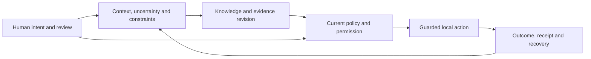

# Lycheetah Framework

**Keep the reasons, uncertainty and human choices intact as intelligence changes.**

Lycheetah is an open research and software project by **Mackenzie Conor James Clark**
in Ōtepoti / Dunedin, New Zealand. It develops tools for human–AI collaboration:
carrying context between sessions, revising knowledge when evidence changes,
controlling which actions may run, and keeping a record of what happened.

The practical problem is familiar. A conversation gets compressed. A decision moves
between people or agents. The conclusion survives, but its caveats, dissent,
permission limits or recovery plan disappear. Lycheetah makes those parts explicit
so they can be inspected, compared and preserved.

The repository also holds the theories, cultural inquiry, learning designs,
philosophy and stories behind that work. Each branch has its own purpose and
evidence; a working software check does not validate every associated theory.

**Status · 21 October 2026:** research software with implemented local controls,
versioned experiments and open questions. The Python package source declares
**1.3.0**; language, paper and creative editions have their own versions.

[Start using a tool](#start-using-a-tool) · [Run the software](#run-the-software) ·
[How the parts fit](#how-the-parts-fit) · [Evidence and current limits](#evidence-and-current-limits) ·
[Repository map](00_Sovereign_Index.md) · [Current synthesis](13_SYNTHESIS_REPORTS/CURRENT_FRAMEWORK_SYNTHESIS.md)

## Start using a tool

| What you want to do | Start here | What it establishes |
|---|---|---|
| Carry goals, uncertainty, permission and recovery into another session | [Handover tool and worked comparisons](examples/meaning_handover/README.md) · [browser preview](https://lycheetah.github.io/Lycheetah-Framework/lamague-handover.html) | Inspectable structured records and format comparisons; human benefit remains to be measured. |
| Check an existing JSON decision record for missing accountability fields | [LAMAGUE check](03_LAMAGUE_L1/24_LAMAGUE_CHECK/README.md) | Presence and empty-value checks using known field aliases; it cannot establish whether the contents are true. |
| Gate a local tool action and keep a policy receipt | [Quick start below](#run-the-software) · [Assurance Runtime](34_ASSURANCE_RUNTIME/README.md) | Bounded policy, replay, checkpoint and result-recording behavior. |
| Explore knowledge revision and numerical models | [Core engine guide](12_IMPLEMENTATIONS/core/README.md) | Executable models with declared inputs and assumptions. |
| Study the research and challenge its claims | [Paper index](papers/README.md) · [technical review](28_DEFENSE/FULL_FRAMEWORK_REVIEW_2026-10-20.md) | Sources, experiments, counterexamples and unresolved questions. |
| Read the creative work | [Stories and scriptures](LYCHEETAH_MYTHOS/SCRIPTURES_AND_STORIES/README.md) · [Mystery School](14_MYSTERY_SCHOOL/README.md) | Fiction, philosophy and learning materials with their own source and status records. |

## Run the software

Use **Python 3.10 or newer**. From a local checkout:

```sh
git clone https://github.com/Lycheetah/Lycheetah-Framework.git
cd Lycheetah-Framework
python3 -m venv .venv
. .venv/bin/activate
python3 -m pip install -e .
```

On Windows, activate the environment with `.\.venv\Scripts\Activate.ps1` in PowerShell.
The basic examples use local code and require no model-provider account or API key.

### A small action-and-receipt example

This runs a declared local fixture and shows that a separate proposed write needs
review. Its ledger and checkpoint key live in a temporary directory.

```python
from tempfile import TemporaryDirectory
from lycheetah.assurance import ActionGateway

with TemporaryDirectory() as workspace:
    gateway = ActionGateway.open_local(workspace)

    result = gateway.execute(
        action={"tool": "notes.preview", "side_effect": False},
        actor="example-agent",
        scope="notes:read",
        executor=lambda: {"status": "success", "text": "A local preview"},
    )
    print(result.status)                       # SUCCEEDED
    print(result.receipt.policy["id"])         # lycheetah.default

    proposal = gateway.propose(
        action={"tool": "notes.write", "side_effect": True},
        actor="example-agent",
        scope="notes:write",
    )
    print(proposal.disposition.value)          # REVIEW
    print(proposal.allowed)                    # False
```

The gateway evaluates declared actions. The integrating application must authenticate
approvers and connect each action description to the correct executor. A Python
callback is not automatically confined by the description passed alongside it.
An uncertain or uncheckpointed result requires reconciliation before retry.

### Keep an inspectable handoff

The [guarded handoff example](examples/README.md#try-one-local-action-and-inspect-its-record)
connects a task declaration, carried context, one actual local file and its complete
receipt. Choose a new export directory:

```sh
python3 examples/guarded_handoff_risk_demo.py --export ./my-handoff-demo
python3 examples/guarded_handoff_risk_demo.py --verify ./my-handoff-demo
```

Inspect `task.json`, `packet.json`, `action.json`, `handoff.txt` and
`assurance-receipt.json` there. Verification reads the retained records without
running the task again. Changed output, context, receipt or missing files fail
inspection. Retain the printed manifest digest separately to pin the bundle's
bytes; otherwise verification establishes internal consistency. The example uses
synthetic proposals, declared approval labels and a trusted fixed writer.

For an ordinary JSON record, the accountability checker runs without installing
the package:

```sh
python3 03_LAMAGUE_L1/24_LAMAGUE_CHECK/lamague_check.py --demo
python3 03_LAMAGUE_L1/24_LAMAGUE_CHECK/lamague_check.py your-record.json --strict
```

Installed commands include `lycheetah-assure`, `lycheetah-compact`,
`lycheetah-consensus` and `lycheetah-handoff`; use `--help` for their specific inputs.
Optional web and MCP dependencies are declared in [pyproject.toml](pyproject.toml).
See the [package guide](lycheetah/README.md) and [examples](examples/README.md).

## How the parts fit

The architecture connects three responsibilities: **revise what is known,
preserve what matters, and control what may happen next**. Human review and
visible evidence connect them.



This is a design map across separate instruments. The action gateway implements
the policy/checkpoint/execution path; the entire diagram is not one deployed service.

| Responsibility | Main components | Source home |
|---|---|---|
| Knowledge and revision | CASCADE, Truth Pressure, Hybrid Gateway | [Core engines](12_IMPLEMENTATIONS/core/README.md), [Truth Pressure](TRUTH_PRESSURE/README.md), [Gateway research](papers/ai-futures/hybrid-gateway/README.md) |
| Meaning and continuity | LAMAGUE, structured packets, Compaction Shield | [Language branches](03_LAMAGUE_L1/README.md), [maintained package](lycheetah/README.md) |
| Normative commitments | AURA, human primacy, inspectability and reversibility | [AURA](02_AURA_L3/README.md) |
| Permission and execution | Action Gateway, checkpointed workflow, Sovereign Execution Harness | [Assurance Runtime](34_ASSURANCE_RUNTIME/README.md), [public Python interfaces](lycheetah/README.md) |
| Evidence and correction | Claim register, falsification records, reproducible checks | [Defense and evidence](28_DEFENSE/README.md) |
| Learning and creative exploration | Mystery School, Mythos, Epic, generative work | [Learning](14_MYSTERY_SCHOOL/README.md), [stories](LYCHEETAH_MYTHOS/SCRIPTURES_AND_STORIES/README.md), [generative branch](35_ABSTRACT_AND_GENERATIVE/README.md) |

A handover record carries context; it does not grant authority. A policy decision
records a check; it does not prove an external effect. A receipt identifies a
record; it does not independently establish the truth of every statement in it.
These distinctions are part of the design.

## The nine foundational frameworks

The original frameworks supply the project's vocabulary, models and questions.
Their assumptions and evidence are examined in the
[mathematical guide](11_MATHEMATICAL_FOUNDATIONS/README.md) and
[full review](28_DEFENSE/FULL_FRAMEWORK_REVIEW_2026-10-20.md).

| Framework | Central question |
|---|---|
| [CASCADE](01_CASCADE_L4/README.md) | How should represented knowledge reorganize when evidence conflicts? |
| [AURA](02_AURA_L3/README.md) | Which governance commitments should remain inspectable? |
| [LAMAGUE](03_LAMAGUE_L1/README.md) | What meaning and constraints survive a change of representation? |
| [TRIAD](04_TRIAD_L2/README.md) | How can an observe-and-correct process be specified and measured? |
| [MICROORCIM](05_MICROORCIM_L5/README.md) | How can declared intention and observed behavior be compared? |
| [Earned Light](06_EARNED_LIGHT_L0/README.md) | How might energy and sustained organization be modeled? |
| [ANAMNESIS](07_ANAMNESIS_L0/README.md) | How should discovery, recurrence and recognition be understood? |
| [CHRYSOPOEIA](09_CHRYSOPOEIA_L4/README.md) | How can transformation be described through explicit operators? |
| [HARMONIA](10_HARMONIA_L6/README.md) | How can resonance and coordination be modeled? |

The newer [Earned Light agent-control forges](papers/agent-safety/earned-light/README.md)
are a separate experimental line from the older consciousness/energy model.
Their software results do not validate the latter's interpretation.

## Research, governance and the wider work

- [Agent safety](papers/agent-safety/README.md) studies evidence, authority,
  revocation, action, observation and recovery. Earned Trust, Earned Light,
  Sovereign Choice and frontier-control versions retain distinct experiments.
- [LAMAGUE and SXP-L](03_LAMAGUE_L1/README.md) explore formal language,
  representations and constrained meaning preservation across several versions.
- [The Independent No](papers/independent-no/README.md) asks whether refusal can
  remain binding and includes a proposed study.
- [NZ governance](23_NZ_AI_GOVERNANCE/README.md) starts with a proposal for six
  data rights for every New Zealander. Earlier cultural-policy drafts remain
  historical; this is not an adopted national standard.
- [Cross-cultural inquiry](24_LAMAGUE_CROSS_CULTURAL/README.md) and
  [TIANXIA](32_TIANXIA/README.md) hold attributed comparisons and proposed models.
  A mapping does not establish community endorsement.
- [Stories](LYCHEETAH_MYTHOS/SCRIPTURES_AND_STORIES/README.md),
  [learning designs](14_MYSTERY_SCHOOL/README.md) and
  [philosophical work](35_ABSTRACT_AND_GENERATIVE/README.md) explore the human
  meaning of choice, continuity and change.

## Evidence and current limits

The strongest supported claims name a component, version, input and observed
result. Exact record preservation, a rejected replay and a policy receipt are
inspectable software results. Human benefit, general AI safety, psychological
recovery and consciousness require different evidence.

The [technical review](28_DEFENSE/FULL_FRAMEWORK_REVIEW_2026-10-20.md) records
counterexamples to older mathematical guarantees and the code corrections made
in October. On 21 October, **64 new boundary cases** passed across focused runs.
The earlier full maintained run recorded 997 passes, one skip and one strict
expected failure. Those are dated engineering checks, not independent experiments.
A later [focused hardening pass](28_DEFENSE/review_2026_10_20/swarm-hardening.json)
passed 329 cases, including 90 new snapshot, receipt and retained-handoff cases.
The deeper review has inventoried 606 folders; reading and execution coverage
remain incomplete and are [reported explicitly](28_DEFENSE/review_2026_10_20/folder-coverage.json).

Release work remains: missing evidence references, corpus lint and claim-status
footing failures, archive portability, and prototype admission defects. See the
[review and repair sequence](28_DEFENSE/FULL_FRAMEWORK_REVIEW_2026-10-20.md),
[capability guide](33_APPLICATIONS/README.md) and [Failure Museum](28_DEFENSE/FAILURE_MUSEUM.md).

The [claim register](28_DEFENSE/CLAIMS.json) contains 71 structured claim records.
These are the author's classifications, including claims disputed by the review:

| Classification | Records | Meaning |
|---|---|---|
| **ACTIVE** | 52 | An asserted result; inspect its stated assumptions and evidence. |
| **SCAFFOLD** | 12 | An incomplete model or operational link. |
| **CONJECTURE** | 4 | An open claim requiring further evidence. |
| **RETRACTED** | 3 | A withdrawn claim preserved for accountability. |

These counts cover that register, not every later research contribution.
`ACTIVE` does not mean independently replicated, peer-reviewed or production-ready.

## Find your way around

| Location | What belongs there |
|---|---|
| [12_IMPLEMENTATIONS](12_IMPLEMENTATIONS/README.md) | Foundational Python engines, applications, integrations and experiments. |
| [lycheetah](lycheetah/README.md) | Public package interfaces and maintained assurance, compaction and execution controls. |
| [papers](papers/README.md) | Manuscripts, protocols and versioned research packets. |
| [TRUTH_PRESSURE](TRUTH_PRESSURE/README.md) | Evidence/revision instruments and experimental continuations. |
| [28_DEFENSE](28_DEFENSE/README.md) | Claims, evidence, failures, reviews and reproducibility records. |
| [LYCHEETAH_MYTHOS](LYCHEETAH_MYTHOS/README.md) and [LYCHEETAH_EPIC](LYCHEETAH_EPIC/00_EPIC_COVENANT.md) | Creative source worlds and their edition/canon boundaries. |
| [docs](docs/README.md) | Existing website sources and generated reading views. |
| [99_ARCHIVE](99_ARCHIVE/README.md) | Historical work and preserved research releases. |

The [complete repository map](00_Sovereign_Index.md) locates all top-level areas.
[WORKING_HOME.md](WORKING_HOME.md) identifies source ownership; the
[current synthesis](13_SYNTHESIS_REPORTS/CURRENT_FRAMEWORK_SYNTHESIS.md) explains
relationships across the corpus.

## Develop, contribute and cite

Install development dependencies with `python3 -m pip install -e '.[dev]'`.
The [test guide](tests/README.md) describes maintained collection and focused
checks. Keep a change's source, regression evidence and changelog together.
Preserve original research versions and attribute distinctive work to its creator.

Read [CONTRIBUTING.md](CONTRIBUTING.md) and [SECURITY.md](SECURITY.md).
For AI-assisted reading, start with [EXPLORE_WITH_AI.md](EXPLORE_WITH_AI.md) and
[the extraction protocol](26_FOR_AI/AI_EXTRACTION_PROTOCOL.md).

The root [LICENSE](LICENSE) contains MIT terms. Supplied subprojects retain their
own notices; ownership-document inconsistencies are recorded in the review.
[Citation metadata](CITATION.cff) identifies the creator and a dated citation
edition rather than a release certificate for every component.
