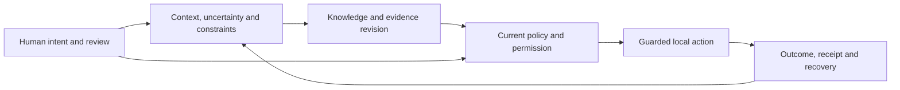

# Lycheetah Framework

**Keep the reasons, the uncertainty and the human choices intact as intelligence changes.**

Lycheetah is an open research and software project by **Mackenzie Conor James Clark**,
built in Ōtepoti / Dunedin, New Zealand. It makes tools for human–AI collaboration
that do four things:

- **carry context** between sessions and between people and agents;
- **revise knowledge** when the evidence changes;
- **control which actions may run**, and under whose authority;
- **keep a record** of what actually happened, so it can be checked later.

The problem it answers is ordinary. A conversation gets compressed, or a decision passes
from one person or agent to the next. The conclusion survives, but the caveats, the
dissent, the permission limits and the recovery plan get lost. Lycheetah makes those
parts explicit so they can be inspected, compared and preserved.

The repository also holds the theory, the philosophy, the learning designs and the
stories behind the work. Each area has its own purpose and its own evidence. A passing
software check validates that software, not every theory that sits beside it.

**Status · 23 October 2026.** Research software with implemented local controls,
versioned experiments and open questions. The Python package declares **1.3.0**.
Language, paper and creative editions carry their own versions. The full maintained
test suite currently runs **1,571 passed, 1 skipped, 2 expected failures**: these are
engineering checks, not independent experiments.

[Use a tool](#use-a-tool) · [Run it](#run-it) · [How it fits together](#how-it-fits-together) ·
[What's new](#whats-new) · [Evidence and limits](#evidence-and-limits) ·
[Find your way](#find-your-way) · [Contribute and cite](#contribute-and-cite)

## Use a tool

| You want to | Start here | What it actually shows |
|---|---|---|
| Carry goals, uncertainty, permissions and recovery into another session | [Handover tool](examples/meaning_handover/README.md) · [browser preview](https://lycheetah.github.io/Lycheetah-Framework/lamague-handover.html) | Inspectable structured records and format comparisons. Whether they help people is still to be measured. |
| Check a JSON decision record for missing accountability fields | [LAMAGUE check](03_LAMAGUE_L1/24_LAMAGUE_CHECK/README.md) | Missing or empty fields, using known aliases. It cannot tell you whether the contents are true. |
| Gate a local tool action and keep a receipt | [Run it](#run-it) · [Assurance Runtime](34_ASSURANCE_RUNTIME/README.md) | Bounded policy, replay refusal, checkpoints and recorded outcomes. |
| Explore knowledge revision and the numerical models | [Core engines](12_IMPLEMENTATIONS/core/README.md) | Executable models with declared inputs and assumptions. |
| Read and challenge the research | [Paper index](papers/README.md) · [technical review](28_DEFENSE/FULL_FRAMEWORK_REVIEW_2026-10-20.md) | Sources, experiments, counterexamples and open questions. |
| Read the creative work | [Stories and scriptures](LYCHEETAH_MYTHOS/SCRIPTURES_AND_STORIES/README.md) · [Mystery School](14_MYSTERY_SCHOOL/README.md) | Fiction, philosophy and learning material, each with its own source and status record. |

## Run it

You need **Python 3.10 or newer**.

```sh
git clone https://github.com/Lycheetah/Lycheetah-Framework.git
cd Lycheetah-Framework
python3 -m venv .venv
. .venv/bin/activate
python3 -m pip install -e .
```

On Windows, activate with `.\.venv\Scripts\Activate.ps1` in PowerShell. The examples
run on local code only. No model-provider account or API key is needed.

### One action, one receipt

This runs a declared local action, then shows that a proposed write is held for review.
The ledger and its checkpoint key live in a temporary directory.

```python
from tempfile import TemporaryDirectory
from lycheetah.assurance import ActionGateway

with TemporaryDirectory() as workspace:
    gateway = ActionGateway.open_local(workspace)

    result = gateway.execute(
        action={"tool": "notes.preview", "side_effect": False},
        actor="example-agent",
        scope="notes:read",
        executor=lambda: {"status": "success", "text": "A local preview"},
    )
    print(result.status)                       # SUCCEEDED
    print(result.receipt.policy["id"])         # lycheetah.default

    proposal = gateway.propose(
        action={"tool": "notes.write", "side_effect": True},
        actor="example-agent",
        scope="notes:write",
    )
    print(proposal.disposition.value)          # REVIEW
    print(proposal.allowed)                    # False
```

**What the gateway does and does not do:**

- It evaluates the actions it is told about. Your application must authenticate
  approvers and connect each action description to the right executor. A Python
  callback is not confined by the description passed next to it.
- An executor answers `{"status": "success"}` or `{"status": "failure"}`. Any other
  answer is recorded as **uncertain** and blocks that action until it is reconciled
  from an authoritative read (`gateway.reconcile(effect_id, outcome, evidence)`, or the
  guard CLI's `reconcile` command). It is never retried blind.
- A local write that cannot be checkpointed blocks every later action. There is no
  automatic recovery from that state.
- Two processes may share a ledger directory. A write that loses the race is refused as
  `audit_checkpoint_stale` and can be retried.
- Sensitive argument keys are redacted **in receipts only**. The local ledger keeps the
  full action and the provider's answer, and those details travel to the checkpoint
  authority. Treat the ledger directory and the authority as holding secrets.
- `open_local` keeps the ledger, its checkpoint history and the signing key in one
  directory. That catches a damaged or rolled-back ledger, but not someone who can
  rewrite the whole directory. For that boundary, run the checkpoint authority in
  another process or host (`make_server`, `CheckpointHTTPClient`).

### Keep an inspectable handoff

The [guarded handoff example](examples/README.md#try-one-local-action-and-inspect-its-record)
ties together a task declaration, carried context, one real local file and its receipt:

```sh
python3 examples/guarded_handoff_risk_demo.py --export ./my-handoff-demo
python3 examples/guarded_handoff_risk_demo.py --verify ./my-handoff-demo
```

Verification reads the retained records without re-running the task. Changed output,
context, receipt or missing files fail. Keep the printed manifest digest somewhere
else to pin the bundle's bytes; without it, verification shows internal consistency only.

To check an ordinary JSON record without installing anything:

```sh
python3 03_LAMAGUE_L1/24_LAMAGUE_CHECK/lamague_check.py --demo
python3 03_LAMAGUE_L1/24_LAMAGUE_CHECK/lamague_check.py your-record.json --strict
```

Installed commands: `lycheetah-assure`, `lycheetah-compact`, `lycheetah-consensus` and
`lycheetah-handoff` (each takes `--help`). Optional web and MCP dependencies are listed
in [pyproject.toml](pyproject.toml). See the [package guide](lycheetah/README.md) and
[examples](examples/README.md).

## How it fits together

Three jobs, joined by human review and visible evidence: **revise what is known,
preserve what matters, control what happens next.**



This is a map across separate instruments, not one deployed service. The action
gateway implements the policy → checkpoint → execution path.

| Job | Main components | Where it lives |
|---|---|---|
| Knowledge and revision | CASCADE, Truth Pressure, Hybrid Gateway | [Core engines](12_IMPLEMENTATIONS/core/README.md) · [Truth Pressure](TRUTH_PRESSURE/README.md) · [Gateway research](papers/ai-futures/hybrid-gateway/README.md) |
| Meaning and continuity | LAMAGUE, structured packets, Compaction Shield | [Language](03_LAMAGUE_L1/README.md) · [package](lycheetah/README.md) |
| Commitments | AURA: human primacy, inspectability, reversibility | [AURA](02_AURA_L3/README.md) |
| Permission and execution | Action Gateway, checkpointed workflow, Sovereign Execution Harness | [Assurance Runtime](34_ASSURANCE_RUNTIME/README.md) · [package](lycheetah/README.md) |
| Evidence and correction | Claim register, falsification records, reproducible checks | [Defense and evidence](28_DEFENSE/README.md) |
| Learning and creative work | Mystery School, Mythos, Epic, generative work | [Learning](14_MYSTERY_SCHOOL/README.md) · [stories](LYCHEETAH_MYTHOS/SCRIPTURES_AND_STORIES/README.md) · [generative](35_ABSTRACT_AND_GENERATIVE/README.md) |

Three distinctions are part of the design. A handover record carries context; it does
not grant authority. A policy decision records a check; it does not prove an external
effect happened. A receipt identifies a record; it does not prove every statement in it.

### The nine foundational frameworks

These supply the project's vocabulary, models and questions. Their assumptions are
examined in the [mathematical guide](11_MATHEMATICAL_FOUNDATIONS/README.md) and the
[full review](28_DEFENSE/FULL_FRAMEWORK_REVIEW_2026-10-20.md).

| Framework | Its question |
|---|---|
| [CASCADE](01_CASCADE_L4/README.md) | How should knowledge reorganise when evidence conflicts? |
| [AURA](02_AURA_L3/README.md) | Which governance commitments must stay inspectable? |
| [LAMAGUE](03_LAMAGUE_L1/README.md) | What meaning and constraints survive a change of representation? |
| [TRIAD](04_TRIAD_L2/README.md) | How can an observe-and-correct process be specified and measured? |
| [MICROORCIM](05_MICROORCIM_L5/README.md) | How can declared intention be compared with observed behaviour? |
| [Earned Light](06_EARNED_LIGHT_L0/README.md) | How might energy and sustained organisation be modelled? |
| [ANAMNESIS](07_ANAMNESIS_L0/README.md) | How should discovery, recurrence and recognition be understood? |
| [CHRYSOPOEIA](09_CHRYSOPOEIA_L4/README.md) | How can transformation be described with explicit operators? |
| [HARMONIA](10_HARMONIA_L6/README.md) | How can resonance and coordination be modelled? |

The newer [Earned Light agent-control forges](papers/agent-safety/earned-light/README.md)
are a separate experimental line from the older energy model. Their software results
do not validate that model's interpretation.

## What's new

- **[AI Future Wings](papers/ai-futures/wings/README.md):** fifteen working research
  drafts, one for each domain of the AI Future curriculum, from Science and Politics to
  Embodiment and Development. Each one turns a domain into an instrument a study could use: the monoculture
  ceiling for correlated AI majorities, the withdrawal test for real capability, the
  returned-time test, the control horizon for remote bodies, matched-mind divergence.
  Every number in them is synthetic, comes from one standard-library
  [`models.py`](papers/ai-futures/wings/models.py), and is pinned by
  `tests/test_ai_future_models.py`. None of the studies has been run.
- **[Full-framework review](FOR-REVIEW/README.md):** a folder-by-folder review in
  37 batches plus an 18-item mathematics checklist, with findings ledgers, reproduction
  scripts and the fixes it made. Its ledgers keep retracted claims beside their causes
  rather than deleting them.

## Research, governance and the wider work

- [Agent safety](papers/agent-safety/README.md): evidence, authority, revocation,
  action, observation and recovery. Earned Trust, Earned Light, Sovereign Choice and
  the frontier-control versions keep their own experiments.
- [LAMAGUE and SXP-L](03_LAMAGUE_L1/README.md): formal language, representation and
  constrained meaning preservation, across several versions.
- [The Independent No](papers/independent-no/README.md): can a refusal stay binding?
  Includes a proposed study.
- [NZ governance](23_NZ_AI_GOVERNANCE/README.md): starts from a proposal for six data
  rights for every New Zealander. This is a proposal, not an adopted national standard.
- [Cross-cultural inquiry](24_LAMAGUE_CROSS_CULTURAL/README.md) and
  [TIANXIA](32_TIANXIA/README.md): attributed comparisons and proposed models.
  A mapping is not community endorsement.
- [Stories](LYCHEETAH_MYTHOS/SCRIPTURES_AND_STORIES/README.md),
  [learning designs](14_MYSTERY_SCHOOL/README.md) and
  [philosophy](35_ABSTRACT_AND_GENERATIVE/README.md): the human meaning of choice,
  continuity and change.

## Evidence and limits

The strongest claims here name a component, a version, an input and an observed result.
Exact record preservation, a refused replay and a policy receipt are software results
you can inspect yourself. Human benefit, general AI safety, psychological recovery and
consciousness would need different evidence, and none of it is claimed.

The [technical review](28_DEFENSE/FULL_FRAMEWORK_REVIEW_2026-10-20.md) records
counterexamples to older mathematical guarantees and the code corrections that
followed. Coverage is reported honestly in
[folder-coverage.json](28_DEFENSE/review_2026_10_20/folder-coverage.json), and the
work still open before a release is listed in the review's repair sequence, the
[capability guide](33_APPLICATIONS/README.md) and the [Failure Museum](28_DEFENSE/FAILURE_MUSEUM.md).

The [claim register](28_DEFENSE/CLAIMS.json) contains 71 structured claim records.
These are the author's own classifications, including claims the review disputes:

| Classification | Records | Meaning |
|---|---|---|
| **ACTIVE** | 52 | An asserted result. Inspect its assumptions and evidence. |
| **SCAFFOLD** | 12 | An incomplete model or link. |
| **CONJECTURE** | 4 | An open claim that needs more evidence. |
| **RETRACTED** | 3 | Withdrawn, and kept on record for accountability. |

These counts cover the register, not every later contribution. `ACTIVE` does not mean
independently replicated, peer-reviewed or production-ready. Nothing in this repository
has yet been independently replicated; that is the next gap to close.

## Find your way

| Location | What lives there |
|---|---|
| [lycheetah](lycheetah/README.md) | The maintained package: assurance, compaction and execution controls. |
| [12_IMPLEMENTATIONS](12_IMPLEMENTATIONS/README.md) | Foundational Python engines, applications, integrations and experiments. |
| [papers](papers/README.md) | Manuscripts, protocols and versioned research packets. |
| [TRUTH_PRESSURE](TRUTH_PRESSURE/README.md) | Evidence and revision instruments, with experimental continuations. |
| [28_DEFENSE](28_DEFENSE/README.md) | Claims, evidence, failures, reviews and reproducibility records. |
| [FOR-REVIEW](FOR-REVIEW/README.md) | Review ledgers and proposals waiting on the author's decisions. |
| [LYCHEETAH_MYTHOS](LYCHEETAH_MYTHOS/README.md) · [LYCHEETAH_EPIC](LYCHEETAH_EPIC/00_EPIC_COVENANT.md) | The creative source worlds and their canon boundaries. |
| [docs](docs/README.md) | Website sources and generated reading views. |
| [99_ARCHIVE](99_ARCHIVE/README.md) | Historical work and preserved research releases. |

The [complete repository map](00_Sovereign_Index.md) covers every top-level area.
[WORKING_HOME.md](WORKING_HOME.md) names who owns which source, and the
[current synthesis](13_SYNTHESIS_REPORTS/CURRENT_FRAMEWORK_SYNTHESIS.md) explains how
the parts relate.

## Contribute and cite

Install the development tools with `python3 -m pip install -e '.[dev]'`. The
[test guide](tests/README.md) explains the maintained suite and the focused checks.
Keep each change's source, its regression evidence and its changelog entry together.
Preserve original research versions, and credit distinctive work to its creator.

Read [CONTRIBUTING.md](CONTRIBUTING.md) and [SECURITY.md](SECURITY.md). For
AI-assisted reading, start with [EXPLORE_WITH_AI.md](EXPLORE_WITH_AI.md) and the
[extraction protocol](26_FOR_AI/AI_EXTRACTION_PROTOCOL.md).

The root [LICENSE](LICENSE) is MIT. Supplied subprojects keep their own notices;
inconsistencies between ownership documents are recorded in the review.
[CITATION.cff](CITATION.cff) identifies the creator and a dated citation edition. It is
not a release certificate for every component.
