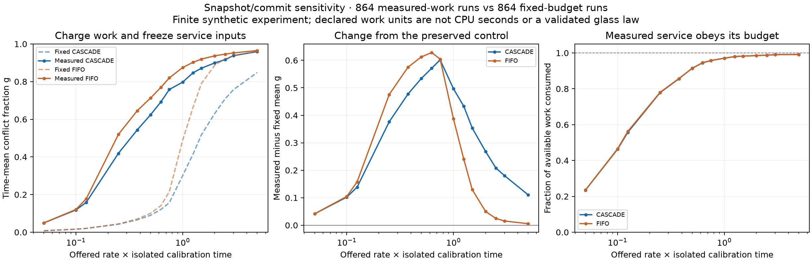

# Load-aware CASCADE result: the advantage shrinks

**After charging measured semantic work and freezing service snapshots, CASCADE's
observed conflict-reduction advantage falls from 9.80 to 5.49 percentage points.**
That is a 43.9% reduction in this paired synthetic comparison. The earlier result
is retained intact as the fixed-budget control.

Author: Mackenzie Conor James Clark / Lycheetah Framework.
Design and implementation: Caelorynth / Codex, 2026-10-17.
Register: SYNTHETIC. Local, uncommitted; independent review pending.

## What changed and what stayed fixed

The [v2 protocol](LOAD_AWARE_PROTOCOL.md) was written before the new sweep. Each
service now reads a frozen snapshot at its start, executes actual CASCADE/FIFO
adjudication on that snapshot, and pays its measured contradiction comparisons
and layer assignments divided by the selected processing rate. Only observed
changes commit at completion. Later arrivals survive unchanged and cannot supply
foreknowledge to a service already in flight.

The original source, [v1 protocol](PROTOCOL.md), raw results and figure remain the
fixed-service control. **All 864 new rows match the original proposal-trace hashes**
for their corresponding model, topology, seed, processing rate, offered rate and
compatible/contradictory condition. There are 432 CASCADE–FIFO pairs per variant,
including 216 contradictory-stream pairs. These are paired model runs, not 1,728
independent natural observations.

## Result

| Descriptive observation | Fixed budget / completion-time inputs | Measured work / start-time snapshot |
|---|---:|---:|
| CASCADE low nominal-load mean g | 0.0468 | 0.3694 |
| CASCADE high nominal-load mean g | 0.7363 | 0.9284 |
| FIFO low nominal-load mean g | 0.0504 | 0.4323 |
| FIFO high nominal-load mean g | 0.9263 | 0.9502 |
| CASCADE advantage over FIFO, contradictory pairs | 9.80 percentage points | 5.49 percentage points |
| Compatible-overload semantic g | 0 | 0 |
| Maximum semantic g after draining | 0 | 0 |

The fixed low/high groups remain V <= 0.5 and V >= 2, using the independently
calibrated **clean-store** reorganisation time. The much higher conflict below
nominal V = 1 shows that this isolated timing estimate is a poor admission-rate
setpoint for a growing store. It does not falsify every possible load-dependent
definition of tau, or establish a critical point elsewhere.

Actual work per service is 2.42–5.28 times isolated calibration, mean 3.69 across
rows. Unlike v1, that work is charged. All 864 rows obey their elapsed processing
budget; the maximum absolute discrepancy between the independently accumulated
event timeline and work accounting is **3.64e-12 work units**. In-flight partial
work is included at the observation horizon.

Compatible overload queues as many as **88 proposals while semantic g stays zero**.
Every run still clears all conflicts when allowed to drain. Neither queueing nor
these transient contradictions demonstrate irreversible freezing.



## Interpretation and remaining limits

The apparent advantage depends materially on service-cost and timing assumptions.
The source hypothesis remains a conjecture. No sharp/first-order transition was
required or inferred, consistent with the source canon's explicit fence.

Two assumptions changed together: the work charge and snapshot timing. This
comparison measures their combined effect; it does not allocate the 43.9% change
between them. A factorial separation would be needed for that attribution.

The counter measures declared semantic operations, not CPU time. Copying,
selection, observation, persistence, parallelism, network latency and provider work
are not charged. Graph topology changes proposal correlation, while dependency
metadata remains uninterpreted by the core. Scores and labels are synthetic.
These results do not validate natural-language truth, substrate independence,
real-agent capacity or a production governor.

The next timing hinge is an online estimate of work under the current store state,
tested against an ordinary work-budget admission baseline. A governor must expose
external waiting/backlog and admitted throughput; it must not claim success merely
by hiding unadmitted contradictions from its sensor.

## Reproduce and inspect

```bash
python3 12_IMPLEMENTATIONS/core/cascade_glass_dynamic.py \
  --output TRUTH_PRESSURE/EXPERIMENTS/GLASS_TRANSITION/load_aware.json \
  --csv TRUTH_PRESSURE/EXPERIMENTS/GLASS_TRANSITION/load_aware.csv

MPLCONFIGDIR=/tmp/lycheetah-glass-mpl python3 \
  TRUTH_PRESSURE/EXPERIMENTS/GLASS_TRANSITION/plot_load_aware.py \
  --fixed TRUTH_PRESSURE/EXPERIMENTS/GLASS_TRANSITION/results.json \
  --measured TRUTH_PRESSURE/EXPERIMENTS/GLASS_TRANSITION/load_aware.json \
  --output TRUTH_PRESSURE/EXPERIMENTS/GLASS_TRANSITION/load_aware.png

python3 -m pytest tests/test_cascade_glass_dynamic.py -q
```

- [Raw JSON](load_aware.json): 864 rows, sample service traces, independent
  calibration, work accounting and four source/protocol hashes.
- [Raw CSV](load_aware.csv): the same 864 rows, with service samples encoded as JSON.
- [SVG figure](load_aware.svg): standalone export.
- [V2 artifact manifest](load_aware_manifest.json): exact source/result identities.
- **16 focused tests passed** on the final model. A false work receipt is caught;
  cutting commits exposes undrained conflicts; future arrivals cannot rewrite a
  prior snapshot; both rate interventions preserve matched input traces.

The original 20 v1 checks and this variant's 16 checks cover different model
boundaries. Full-repository CI, independent cross-seat review, empirical-domain
trials, package promotion and publication remain open.
