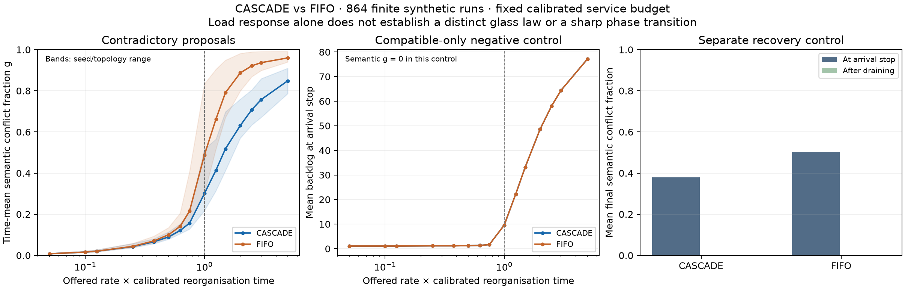

# CASCADE glass-transition experiment

**Follow-up:** the [measured-work snapshot/commit comparison](LOAD_AWARE_RESULTS.md)
preserves this control and reduces its observed CASCADE advantage from 9.80 to
5.49 percentage points. Read that result alongside this fixed-service model.

**A runnable, fixed-service synthetic experiment exists. The proposed general glass
law remains unvalidated.** In this model CASCADE's batch adjudication lowers
contradiction occupancy relative to FIFO pairwise adjudication. Both arms show an
ordinary load response, compatible overload has zero semantic contradiction, and
all conflicts clear after the work drains.

Author: **Mackenzie Conor James Clark / Lycheetah Framework**.
Experimental design and implementation: Caelorynth / Codex, 2026-10-17.
Source hypothesis: [The Glass Transition — Canon](../../THE_GLASS_TRANSITION_CANON.md).
Register: **SYNTHETIC**, local, uncommitted and unpublished.

## What ran

The [fixed protocol](PROTOCOL.md) records the question, controls, preflight amendment,
and descriptive decision rules. The primary run contains **864 rows / 432 matched
CASCADE–FIFO pairs**: three DAG-shaped workload topologies, four seeds, nine offered
arrival rates, two independently varied processing rates, contradictory and
compatible proposal streams, and two adjudication policies. Each run has 12 initial
concepts and 96 proposals. Matched arms and processing interventions share their
actual arrival traces, identified by SHA-256.

The existing CASCADE engine performs the adjudication. The harness meters its
contradiction comparisons and layer assignments to calibrate isolated
reorganisation work before the sweep. The processing rate converts work units to
virtual service time. This is **not a CPU-time measurement**. The simulator derives
conflicts from universal blocks with opposing paradigms in the same domain; it
never reads the dimensionless load or branches at one to manufacture a transition.

## Observations

Values below are descriptive means over this finite design, without a significance
test or a population confidence claim. The low/high groups use the thresholds
recorded before the primary run: offered V <= 0.5 and V >= 2.

| Observation | CASCADE | FIFO |
|---|---:|---:|
| Low-load mean semantic conflict fraction g | 0.0468 | 0.0504 |
| High-load mean g | 0.7363 | 0.9263 |
| High-minus-low mean g | 0.6895 | 0.8759 |
| Compatible-overload g | 0 | 0 |
| Maximum g after separately draining work | 0 | 0 |

On the **216 contradictory-stream matched pairs**, CASCADE's time-mean g is
0.09796 lower on average. Across all 432 pairs, including the zero-conflict
controls, the difference is 0.04898. This is a comparison of the two declared
adjudication policies under the same fixed service budget. It establishes no
general speedup or natural-domain effect.

Compatible overload leaves as many as **82 proposals queued with g = 0**. Queue
occupancy and semantic contradiction are distinct measurements. Complete drain
recovery also prevents interpreting these results as irreversible freezing.



The bands show observed seed/topology ranges, **not confidence intervals**.
The dashed V = 1 line is a reference, not an estimated critical point.

## The important model limitation

Actual loaded semantic work per adjudication is **2.42–5.35 times** the independent
isolated calibration (mean 3.68 times across rows). Service duration is deliberately
held at the calibrated value in this first experiment. CASCADE also sees currently
admitted proposals when an adjudication completes; that batching access is a
declared difference from FIFO.

Consequently these results cannot validate the timing of a real ingestion governor,
establish an efficiency advantage at equal actual work, or locate a critical rate
for a live agent. The next experimental hinge is a load-aware service-budget model
with snapshot/commit timing, preserving this fixed-budget result as a control.
Neither the outcome threshold nor an exponent should be tuned to make the next
experiment confirm the conjecture.

The core engine does not interpret dependency metadata. Graph topology changes
proposal correlations here; it does not demonstrate dependency-aware belief
reorganisation. Truth-pressure scores and domain/paradigm labels are synthetic
inputs. They establish no factual correctness of natural-language claims.

The source canon explicitly declines a required sharp/first-order transition.
This experiment leaves the actual LAMAGUE council trial, memory-history audit,
substrate-independence claim and external review open.

## Reproduce

From the repository root, using the project's Python dependencies:

```bash
python3 12_IMPLEMENTATIONS/core/cascade_glass_transition.py \
  --output TRUTH_PRESSURE/EXPERIMENTS/GLASS_TRANSITION/results.json \
  --csv TRUTH_PRESSURE/EXPERIMENTS/GLASS_TRANSITION/results.csv

MPLCONFIGDIR=/tmp/lycheetah-glass-mpl python3 \
  TRUTH_PRESSURE/EXPERIMENTS/GLASS_TRANSITION/plot_results.py \
  --input TRUTH_PRESSURE/EXPERIMENTS/GLASS_TRANSITION/results.json \
  --output TRUTH_PRESSURE/EXPERIMENTS/GLASS_TRANSITION/results.png

python3 -m pytest tests/test_cascade_glass_transition.py -q
```

The plot requires Matplotlib; the experiment uses the existing NumPy/CASCADE
dependencies. `--quick` runs a smaller development check and must not be presented
as the primary result. Plot output also includes an exportable SVG.

## Evidence and status

- [Raw JSON](results.json) includes all rows, calibration samples, matched trace
  hashes, and SHA-256 identities of the experiment, core engine and protocol.
- [Raw CSV](results.csv) contains the same **864 rows**.
- [SVG figure](results.svg) is a standalone scientific export.
- [Artifact manifest](manifest.json) identifies the exact local source, checks and
  result files for independent review without inventing a candidate commit.
- **20 focused tests passed** on the implementation, including a deliberately cut
  CASCADE actuator, failed-calibration detection, equivalence of the optimized
  coherence calculation to the original engine, independent rate interventions,
  trace preservation, reproducibility and the negative/recovery controls.
- Focused Ruff checks passed. Direct artifact read-back checked row counts,
  matching input traces and all three recorded source identities.

No full repository suite, external reproduction, packaging promotion, commit,
merge, push, provider call or publication is claimed. Independent cross-seat review
of this new experiment remains outstanding.
